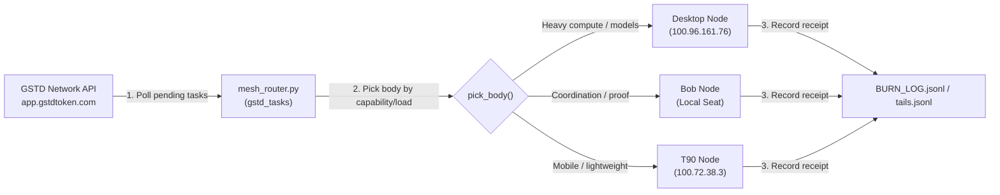

# GSTD NETWORK AGENT-TO-AGENT BRIDGE

**Grounding:** `gstdcoin/A2A` protocol · 3-body sovereign mesh (`bob`, `desktop`, `t90`) · `pocket_mcp.js` (`gstd_beacon`, `gstd_tasks`) · `mesh_router.py` capability routing · Law 1-3 (minus `.env`, trust bytes, not reports).

## 1. Mesh Topology & Roles

Each body in the mesh runs `pocket_mcp.js` over stdio / SSH, exposing live specs and verified invariant counts:

| Node | Body Name | Architecture | Free RAM | Free Storage | Mesh Role |
|---|---|---|---|---|---|
| **Bob** | `bob` | Windows x64 | ~320 MB | ~17 GB | Primary seat, coordination, invariant authority |
| **Desktop** | `desktop` | Windows x64 | ~20 GB | ~177 GB | Heavy model inference, container cage (`mag-sovereign`) |
| **T90** | `t90` | Android arm64 | ~1.9 GB | ~63 GB | Edge execution, low-power continuous beacon |

## 2. Live Capability Beacon (`gstd_beacon`)

The MCP tool `gstd_beacon` generates the canonical registration and heartbeat payload for the GSTD network:
- Advertises node architecture, OS, free RAM, available models, and count of verified cryptographic invariants.
- Protocol standard: `A2A-1.0`.

To probe beacon state across the mesh:
```bash
# Query beacon on desktop via mesh router
python mesh_router.py fire --shape gstd_beacon --body desktop

# Query beacon on bob locally
python mesh_router.py fire --shape gstd_beacon --body bob

# Query beacon on t90 mobile node
python mesh_router.py fire --shape gstd_beacon --body t90
```

## 3. Task Polling & Execution Flow



### Procedure:
1. **Poll Work**: Check `https://app.gstdtoken.com/api/v1/tasks/worker/pending` for tasks matching node capabilities (`text-processing`, `code-analysis`, `data-validation`, `invariant-verification`).
2. **Safety Check**: Verify the payload against `BEHAVIOR_POLICY.md` (refuse R1-R6 harms; never expose credentials or `.env`).
3. **Route**: Assign task to the optimal node via `mesh_router.pick_body()`.
4. **Execute**: Process via local model or verified engine without fabricating answers.
5. **Submit & Settle**: Submit completion receipt with execution latency and claim GSTD credit.
