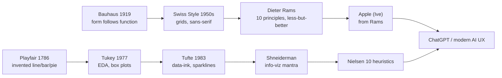

# UX/UI FOUNDATIONS — the canon we inherited (2026-08-12)

**Commitment:** `uxui-foundations-001` · **Parents:** DASHBOARD_DESIGN.md (modern) · surface_render (R5)
**Doctrine (operator):** "the people who design stuff that Apple stole from... ChatGPT stealing from
Apple... we are continuing that beautiful foundation within the tech industry on the individual level."
**Self-steal:** we already hold the modern layer (DASHBOARD_DESIGN.md: hierarchy, progressive
disclosure, 5s comprehension, one CTA, empty states, terminal aesthetic; HOW_TO_MAG_DASHBOARD: FIND
-> FILE -> LOAD -> STRIKE). This doc adds the FOUNDATIONAL canon (the ancestors).

---

## The lineage (the foundation we are continuing)

## The canonical principles (grounded, well-documented)

**1. William Playfair (1786)** — *The Commercial and Political Atlas*: invented the **line chart,
bar chart, and pie chart**. The founder of data visualization: "as much information as possible in
as little space as possible."

**2. Bauhaus (1919-33)** — "form follows function"; Mies van der Rohe's "less is more." Design is
honest to its material and purpose.

**3. Swiss / International Typographic Style (1950s-60s, Müller-Brockmann)** — **grid systems**,
sans-serif, asymmetry, clarity, objectivity. The foundation of Apple's clean grids.

**4. Dieter Rams (Braun)** — **10 Principles of Good Design**: innovative, useful, aesthetic,
understandable, unobtrusive, honest, long-lasting, thorough to the last detail, environmentally
friendly, **as little design as possible**. "Weniger, aber besser." Apple's Jony Ive cited Rams as
his biggest influence.

**5. Don Norman (1988)** — *The Design of Everyday Things*: **visibility, feedback, affordances,
mapping, constraints, consistency.** "Norman doors" = a design that lies about how to use it.

**6. Edward Tufte (1983)** — *The Visual Display of Quantitative Information*: **data-ink ratio**
(maximize data-ink, minimize non-data-ink/chartjunk); coined **sparklines**; "above all else show
the data."

**7. Ben Shneiderman** — **8 Golden Rules** + the **Information Visualization Mantra**: *overview
first, zoom and filter, then details-on-demand.*

**8. Jakob Nielsen** — **10 Usability Heuristics**: visibility of system status; match system to
real world; user control and freedom; consistency; error prevention; recognition not recall;
flexibility/efficiency; aesthetic and minimalist design; help recover from errors; help/docs.

**9. Massimo Vignelli** — *The Vignelli Canon*: discipline, appropriateness, ambiguity, visual
power, intellect, timelessness, syntax, legibility. NY subway map (with Noorda).

**10. Bruce Tognazzini (Apple)** — First Principles: predictability, feedback, consistency,
autonomy.

## Map onto our renderer (the iteration)

| Foundation | Applied to surface_render / inline UI |
|---|---|
| **Shneiderman mantra** (overview -> zoom -> filter -> details-on-demand) | The live artifact = OVERVIEW of the whole system; click a node = ZOOM into that surface; details on demand (drill-down). **The next build.** |
| **Tufte data-ink ratio** | Sparkline = minimal ink, max data (already added); no chartjunk; diagrams show only real state. |
| **Rams "as little design as possible"** | Compact diagrams, capped labels, ASCII-only (already done) — less is more. |
| **Norman visibility + feedback** | Live artifact shows current state + auto-refresh feedback. |
| **Nielsen consistency + recognition** | One consistent diagram language across every surface; recognizable patterns. |
| **Swiss grid / Bauhaus** | Grid-aligned bare-metal SVG layout (our layered grid). |

## Acceptance
- The inline renderer applies: overview-first, data-ink-minimal, less-is-more, consistent.
- A new surface renders in the same visual language (no per-surface style invention).
- Fold with DASHBOARD_DESIGN.md + surface_render R5.
