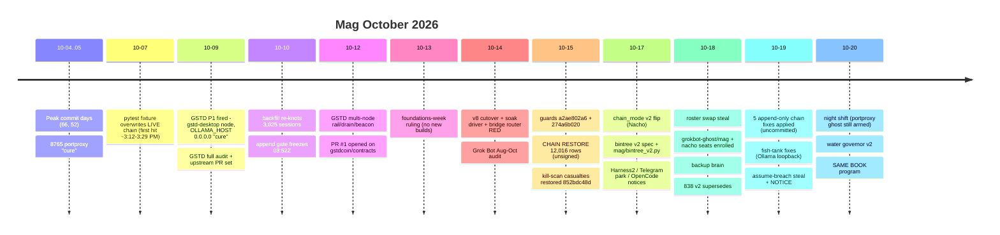

# OCTOBER MAP + GAP ANALYSIS - 2026-10-01 .. 2026-10-20

Written 2026-10-20 ~11:40 AM EDT by Grok Bot (executor). READ-ONLY: git log/status only (no git writes), no secrets, no restarts, no paid calls.
Tiers: **V** = verified on disk / live today · **R** = from an older report (cited) · **I** = inference.

## Sources read
- git log since 10-01: 396 commits, HEAD 129a0fd6e (10-20 11:06 EDT). Working tree: 253 modified + 1,566 untracked
- memory/biography/verkle_chain.jsonl: 13,137 rows; rows per day counted by `ts`
- watch/LIBRARY/INDEX.md (58 lines; only covers 10-17 onward, regenerated 10-17 by inbox_librarian)
- watch/inbox/CHAIN_RESTORE_20261015.md; CHAIN_FIXES_APPLIED_20261019.md
- fleet notices (mag.fleet_report.notices); memory/attention.md tail
- scheduled task results (10-20); gstdcoin/contracts PR #1 (GitHub API)
- box: /workspace/MAG_AUDIT_AUG_OCT_2026.md (10-14), /workspace/verkle-v2/ (BINTREE_V2_SEED_SPEC.md 10-17)

## Activity shape (V)
| Day | commits | chain rows | | Day | commits | chain rows |
|---|---|---|---|---|---|---|
| 10-01 | 10 | 710 | | 10-11 | 7 | 0 |
| 10-02 | 21 | 698 | | 10-12 | 12 | 0 |
| 10-03 | 20 | 3,481 | | 10-13 | 7 | 0 |
| 10-04 | 66 | 94 | | 10-14 | 20 | 0 |
| 10-05 | 52 | 75 | | 10-15 | 31 | 0 |
| 10-06 | 22 | 167 | | 10-16 | 5 | 46 |
| 10-07 | 44 | 139 | | 10-17 | 3 | 141 |
| 10-08 | 13 | 125 | | 10-18 | 21 | 839 |
| 10-09 | 16 | 189 | | 10-19 | 3 | 117 |
| 10-10 | 7 | 49 | | 10-20 | 16 | 3 (by 11 AM) |

The 10-11..10-15 chain silence is the append-gate freeze (tip/chain root mismatch from 10-10 03:52Z until the restore). The 10-18 spike = 838 v2 "supersedes" correction rows (attention.md, 10-20).

## Timeline (key beats)

## Since yesterday 17:35 EDT (V)
- Tip witness ran 10-20 09:30: **exit 2 again** (gist-scope 403). attention.md: "dark its whole life: 20 fires 09-30 to 10-19, all 403, 0 publishes"
- Admin lockdown script **NOT run**: portproxy 0.0.0.0:8765 still present, 22/8080/8765 still on wildcard. Commit 8fbe72bbc (10-20) independently re-confirms "portproxy ghost confirmed armed"
- N-20261019-fish-tank-and-estate-hardening: **0 ACKs**. The two 10-17 OpenCode notices have 1 ACK each (bob only)
- No new seat receipts since 17:25 yesterday. 16 commits today (night shift, water governor, SAME BOOK, Nous Beam free week)

## Gap analysis by workstream
| # | Workstream | Promised / ruled | On disk today | Status | Tier |
|---|---|---|---|---|---|
| 1 | Chain integrity | Restore (10-15), guards, v2 append-only (10-17), 5 fixes (10-19) | Chain honest: 13,137/13,137 roots re-fold, tip matches (attention 10-20). mag/verkle_knot.py, tests/conftest.py, mag/cast_guard.py still `M` (uncommitted). Restore UNSIGNED. Prefix seal RED by design. chain_guard blind to 271,993 knots_attic files | partial | V |
| 2 | Off-machine witness | tip_witness daily since 09-30 | 0 publishes ever; 403 every day | **rotted silently** | V |
| 3 | Backups | backup_chain verify + pin (10-15); offsite (09-30 audit row 18) | Daily same-disk backups OK; offsite never scheduled; only C: exists | partial / never started (offsite) | V |
| 4 | Bintree v2 (Nacho ruled 10-17: binary tree, EIP-7864) | Spec + spike | Spec draft on box; mag/bintree_v2.py + tests UNTRACKED since 10-17; NOT the live writer. Live "chain_mode: v2" = append-only supersedes in the v1 file. **Two things named "v2"** | stalled (draft) | V |
| 5 | GSTD | Foundations week 10-13 = no new builds; PR #1 upstream | v8 deployed/cutover 10-14 (a drift from that ruling, per the 10-14 audit). PR #1: open, 22 commits, 0 comments, last update 10-15. Soak 30/34 settled + 16 not attempted (R). TON mainnet float demoted 10-19 (007dc4008) | partial; ruling contradicted | V/R |
| 6 | Fish tank / host exposure | Approved 10-19 | Ollama loopback done; beacon lease + cast 8767 code done (uncommitted); admin script not run | partial (waits on admin) | V |
| 7 | Seat auth | Handshake, seat keys, roster swap | ghost/mag/nacho enrolled (10-18); handshake still off by default; grokbot-research/newbot/... tombstoned | partial | V |
| 8 | Notices / estate comms | fleet_report notices (10-17) | Works, but only bob ACKs; 10-19 notice unACKed | partial | V |
| 9 | Telegram / Hermes | Telegram parked ≥10-14 on a revoked token | Hermes gateway alive (Discord outbound seen 10-19); Telegram still parked | stalled (waits on Nacho token) | R/V |
| 10 | OpenCode keys | Breach + unused-keys notices 10-17 | In force; ACK'd by bob only. Rotation evidence not found in this pass | open | V/I |
| 11 | Scheduled tasks | Green crons | Non-zero 10-20: KeyAudit 1, Ratchet 1, CensusPatrol 1, EstateSmith 1, GapSentinel 1, LongrunnerPatrol 1, TipWitness 2, DiskSmith 267014, HermesBurn247/ProbeCadence 0x800710E0 (refused/overlap). **Same red set the 10-14 audit listed** | rotted | V (+R for 10-14) |
| 12 | Stale configs | Fossil census | mates.yaml -> missing tools/leave_protocol.py; memory/improve/SEATS.md stale 381h; jev trail 740h; LIBRARY INDEX only from 10-17; state/CURRENT.md (R: cited stale PR head) | rotted | V |
| 13 | Uncommitted work | "commit order owed" (attention 10-20) | 253 modified tracked files, the oldest dated 10-09 (tools/gap_gauges.py, server/server.py, dashboard/static/index.html, mesh_delta). A fresh checkout lacks the 10-19 chain fixes | contradicted (receipts say landed; git says not) | V |
| 14 | Ollama bind | 10-09 cure set 0.0.0.0 for gstd-desktop's 10 garden models; 10-19 set it back to 127.0.0.1 | Container path verified OK; whether gstd-node's own model calls still work is unchecked | **seats contradicted each other** | V/I |

## Seats duplicating / contradicting
- The Ollama bind flipped twice (10-09 0.0.0.0 "cure", 10-19 loopback). The portproxy was "cured" on 10-05 but is still armed, re-found 10-17, 10-19 and 10-20 by three different passes
- "v2" means both the append-only mode and the bintree spec
- Tip-witness failure was reported by me (10-19, "since 10-18"); archaeologist cycle 10 says "whole life since 09-30". The latter is correct
- The 10-14 audit's red-cron list is identical six days later: findings get re-filed, but nobody triages them

## Top gaps ranked (smallest next step · who)
1. Tip witness has never published → re-scope the PAT for gist write · **Nacho**
2. Chain fixes, fence, cast_guard and other October work are uncommitted (253 files, oldest 10-09) → operator "commit order", grouped by organ · **Nacho GO**, a seat executes
3. Admin lockdown script not run (8765/22/8080) → run scripts/host_lockdown_fish_tank_20261019.ps1 elevated · **Nacho (admin)**
4. memory/biography Modify ACL for sandbox SIDs + AdjudicationBus running from the etfag profile → ACL to RX; confirm or disable the task · **Nacho (admin)**
5. Offsite backup never started → pick a medium, then a weekly `backup_offsite.ps1 -Verify` · **Nacho**
6. The 10-14 red cron set is still red → open each log once; tombstone or fix (start with LeaveProtocol/mates.yaml and the KeyAudit/Ratchet findings) · a seat
7. chain_guard blind to knots_attic + stale marker; restore unsigned; prefix re-seal decision → GO on the guard cure; sign/re-seal decision · **Nacho**, then a seat
8. Bintree v2 untracked and unwired; name collision with chain_mode v2 → rename/decide: ship the spike as the verifier only, or park it · **Nacho** decision
9. GSTD: PR #1 idle 5 days, no upstream response; v8 vs foundations ruling → decide to ping upstream or withdraw; reconcile state/CURRENT.md · **Nacho**
10. Notice ACK discipline: only bob ACKs → make RELIEF/boot read notices and ACK (fleet_report already supports it) · a seat
11. (watch) Ollama loopback vs gstd-node models: test one gstd-node inference · a seat

## Falsifiability
Wrong if: a gist publish appears in logs/tip_witness.log; `git status` shows the 10-19 fixes committed; netsh shows no 8765 rule; PR #1 has upstream comments.
