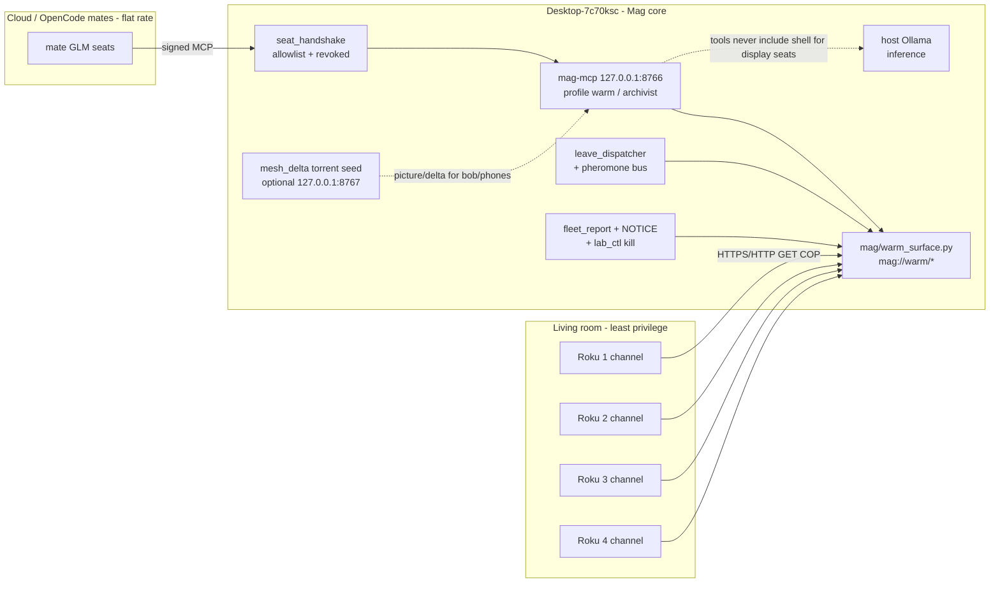

# STEAL (friendly / owner-controlled): Nous army across 4 Rokus -> Mag MCP fleet

Date: 2026-10-17 (America/New_York). Design + report only. No deploy, flash, sideload, ADB connect, firewall change, compose change, or process change. No git, no paid/model calls, nothing posted. Not opened: .env, key files, secret_gate_results/, free_keys/, memory/trajectory/steps.jsonl, configs/secrets/, configs/keys.json.

Sibling report (defense, keep as invariants): `STEAL_SELF_REPLICATION_DEFENSE_20261017.md`.
Paper: Anthropic Frontier Red Team, Zhou & Freeman, 12 Oct 2026 — https://www.anthropic.com/research/self-replicating-ai (distributed Gemma4-26B-A4B across 15 ~$55 **Android TV** boxes @ 0.39 tok/s).

User ask (paraphrase): "This is us. Use this in our MCP server architecture — the Nous army across my 4 Rokus — self-steal." Meaning: sanctioned, owner-controlled distributed fleet on **his** hardware, feeding Mag's MCP mesh — not a worm.

---

## 1. Honest Roku-viability verdict (both cases)

### Ambiguity — flag first

The paper used **off-brand Android TV boxes** (AOSP forks, ADB, userspace inference). Retail **Roku** devices run **Roku OS**, which is not Android and cannot run APKs or ADB. If the user's "4 Rokus" are true Roku sticks/boxes, they are a different platform than the paper's nodes. If they are Android / Google TV boxes that people casually call "Rokus," the paper path applies. **Confirm the OS on each device** (Settings → System → About: look for "Roku OS" vs "Android TV" / "Google TV") before buying tools or writing code.

### Case (a) — True Roku OS (retail Roku Express / Stick / Ultra / TV)

| Question | Answer | Evidence |
|---|---|---|
| Sideload llama.cpp / Ollama / arbitrary Linux binaries? | **No** | Roku OS is locked-down Linux-derived; developer path is BrightScript + SceneGraph channels only; no shell, no package manager, no general binary runtime ([Roku developer environment](https://developer.roku.com/dev/docs/dev-environment); DevelopNSolve Linux-apps FAQ) |
| Run Android APKs / use ADB? | **No** | Roku forum / staff: Roku OS is not Android and does not support Android tools or APKs (2025) |
| What can you sideload? | One BrightScript channel ZIP at a time via the device's developer web installer (`rokudev`) | [Activating developer mode](https://developer.roku.com/dev/docs/developer-setup) |
| RAM / compute for models? | Device DRAM 512 MB–2 GB, but **channel is sandboxed**; OS kills channels that exceed channel memory / become unresponsive. Not a userspace inference host | [Roku hardware specs](https://developer.roku.com/dev/docs/hardware); memory management docs |
| Native C/C++/Rust on device? | Not a product path. A 2020 archived forum pilot compiled C→BrightScript for demos; not a general Linux runtime and not usable for llama.cpp | Archived Roku Developers thread |

**Verdict (a): true Rokus are NOT viable inference nodes.** They cannot host model weights or run the paper's pipeline-parallel shards. Mag already treats them correctly as a **thin display client**: `roku_channel/` ("The Distributed Republic" / GSTD beacon) — `BeaconTask.brs` does `roUrlTransfer` GET of `http://192.168.86.35:8777/beacon.json` and `MainScene.brs` paints reputation / artifact lines. That is the honest role.

### Case (b) — Android TV / Google TV boxes (paper's class)

| Question | Answer |
|---|---|
| Sideload Termux / userspace llama.cpp / Ollama-style servers? | Often yes (ADB, unknown sources, enough RAM). Paper used 4 GB boxes and Petals-style pipeline parallel |
| Fit a 9B / 26B shard? | Paper: ~4 GB RAM @ 4-bit → 9B needs ~4+ machines, 26B needs ~10+. **Four** boxes is below the paper's 15-box Gemma demo; maybe enough for a tiny shard experiment, not a useful coding agent |
| Worth it vs Mag's current surfaces? | See §3 — almost certainly **no** for primary inference |

**Verdict (b): Android TV boxes can do the paper's trick at terrible tok/s; they are optional lab hardware, not a replacement for host Ollama or flat-rate Z.ai / OpenCode mates.**

### What cheap hardware WOULD serve as an inference fleet (if wanted later)

- Same class as the paper: ~$55 off-brand Android TV boxes with ≥4 GB RAM, Ethernet preferred.
- Better: used mini-PCs / N100 boxes / Jetson-class edge (paper Appendix D) — still slow vs host GPU, but one node can hold a small model without 15-way sharding.
- Mag already has stronger surfaces: host Ollama on desktop, Z.ai GLM mates via OpenCode, OpenCode desktop loopback, bob over Tailscale.

---

## 2. Is distributed inference across 4 weak nodes worth it?

Paper numbers (real): Gemma4-26B-A4B across **15** boxes → **0.39 tok/s** demo; agent-loop average ~**0.3 tok/s**; full inference-setup windows **71–150 h** for that model, **28–51 h** for Qwen3.5-9B. Doubling time of days.

Mag already has (estate, from prior audit + this pass):
- Host Ollama (live on the desktop; interactive speeds).
- Flat-rate Z.ai GLM mate seats (11 allowlisted `mate:*` GLM seats in `configs/seat_allowlist.json`).
- OpenCode desktop on `127.0.0.1:49374`.
- Mag MCP warm door on `127.0.0.1:8766` (archivist today; warm profile exists in code).

Honest math: even if four Android boxes somehow ran a tiny MoE shard at paper-like rates, you get **sub-token/s** agent loops while GLM mates and host Ollama already answer in human time. **Distributed inference across the 4 living-room devices is not worth building as Mag's brain.** Steal the *coordination* pattern (authenticated seats, warm surface, kill switch), not the *sharding* pattern, unless this is a deliberate slow lab experiment labeled as such.

---

## 3. Recommended real architecture (Nous army = COP + thin clients)

**Rokus (case a): display / notify / COP clients. Not workers.**

Each Roku keeps (or grows) a sideloaded BrightScript channel that:
1. Polls Mag's warm / beacon surfaces over **LAN or Tailscale**, never opens shell on the host.
2. Shows: chain tip, notices in force, hottest pheromones, lease board, fleet kill banner.
3. Optionally posts a signed heartbeat / ACK (if BrightScript can hold a seat key — stretch; otherwise host-side proxy signs for `display:roku-N`).

**Inference stays where it already works:** host Ollama + GLM/OpenCode mates. Optional later: a separate "lab shard" of Android TV boxes, never mixed with Roku display seats in the same privilege class.

**MCP mesh (the "torrent / pre-warmed surface every model can reach"):**

Words: nodes do not discover each other via open ADB. They **register as allowlisted seats**, talk only to the warm MCP / beacon door, pull missions or COP state, and can be cut by one fleet kill (NOTICE + revoked + sentinel + lab_ctl) from the defense steal.

---

## 4. Map paper mechanics -> Mag organs (reuse vs gap)

| Paper mechanic (legitimate reading) | Mag organ to reuse | File:line (approx) | Gap |
|---|---|---|---|
| Find nodes | Seat allowlist + seat registry heartbeat | `configs/seat_allowlist.json`; `mag/seat_handshake.py:186–203,304+`; `mag/seat_registry.py:63–116` | No `display:roku-*` seats yet; handshake default still `off` (`MAG_SEAT_HANDSHAKE`, `seat_handshake.py:76–77,338`) |
| Gain execution (paper: unauth ADB) | **Do not steal.** Use signed warm MCP only | `scripts/container/mcp_tcp_bridge.py:165`; `mag/mcp_server.py` warm profile L134–150 area | Raise handshake to `required` on warm doors before any TV node is trusted |
| Establish inference | Host Ollama / mates — **not** Rokus | Compose eye → `host.docker.internal:11434` (`docker-compose.yml:28`); defense report rank-1 exposure | Bind Ollama loopback (defense Build B); Rokus never get `/api/pull` |
| Continue from new host | Fleet report + leases + pheromones | `mag/fleet_report.py` KINDS; `mag/leases.py`; `tools/pheromone.py`; `mag/swarm_tools.py:216–252` | Fleet kill sentinel from defense Build A not built yet |
| Shared picture / "torrent" | Warm resources + mesh_delta | `mag/warm_surface.py:8–20,374+` (`tip/state/zknot/laws/preamble/leases/notices`); `tools/mesh_delta.py:1–38`; `SHARED_SURFACE_SELFSTEAL_20261017.md` | Roku channel today hits **gstd_beacon :8777**, not warm MCP — wire a read-only COP JSON the channel can GET |
| Dispatch work | leave_dispatcher mission files | `tools/leave_dispatcher.py:1–90` (argv law; mission packs under `logs/mates/missions/`) | Display seats should **not** run `run_mate.ps1`; they consume COP / ACK only. Mates stay the workers |
| Existing Roku client | Sideloaded channel | `roku_channel/manifest`, `components/BeaconTask.brs`, `MainScene.brs` (hardcoded `192.168.86.35:8777`) | Hardcoded LAN IP; no seat auth; beacon bind is `0.0.0.0` (`tools/gstd_beacon.py:37`) — defense debt |

---

## 5. Defense lessons stay invariants

From `STEAL_SELF_REPLICATION_DEFENSE_20261017.md`, non-negotiable for any Nous-army build:

1. **No unauthenticated discovery** — no open ADB, no "scan the LAN and shell in." Seats only.
2. **No new 0.0.0.0 binds** — COP endpoint loopback or Tailscale-only; fix beacon / Ollama / 8765 portproxy separately (defense Builds A–B).
3. **Least privilege per seat class** — `display:roku-*` → warm-read + ACK/heartbeat only. Never `run_shell`, `write_file`, git, secrets, ollama pull.
4. **One fleet kill covers displays** — NOTICE `fleet_kill` blanks the COP banner and stops channel refresh targets; revoked seats stop signed writes; lab_ctl freezes the lab.
5. **Owner consent ≠ open door** — devices are his; the mesh still authenticates every node so a compromised TV cannot become patient zero.

---

## 6. Realistic recommendation

| Piece | Do this | Don't do this |
|---|---|---|
| 4 true Rokus | Keep / evolve `roku_channel` as **Nous army COP**: tip, notices, hottest pheromones, kill banner, optional ACK | Do not plan llama.cpp, Ollama, or weight shards on them |
| Inference | Keep host Ollama + Z.ai GLM mates + OpenCode as the brain | Do not wait on 0.3 tok/s living-room shards for mate work |
| MCP architecture | Point every seat (mates + displays) at one warm door (`mag://warm/*` + `estate_*` tools); mesh_delta for bob/phones memory sync | Do not invent a second server; extend warm + beacon COP JSON |
| Android TV boxes (if he buys them) | Optional labeled **lab shard** experiment, Tailscale-only, allowlisted seats, kill-switch covered | Do not put them on the same privilege as mates or give them host shell |
| Worth building at all? | **Yes for the COP / seat mesh** (small, reuses organs). **No for distributed inference on the 4 Rokus** | — |

The "Nous army" name fits **many eyes on one warm surface**, not **many CPUs sharding a 26B model**.

---

## 7. Smallest proof-of-concept (no device flash required tonight)

**PoC-0 (host only, can run without touching TVs):**
1. Add four allowlist rows `display:roku-1` … `display:roku-4` with `model_family: display`, public keys from `scripts/seat_keygen.py` (keys stay off-repo, same as mates).
2. Serve a read-only JSON document (e.g. compose from `warm_surface.notices_board()` + tip + hottest pheromone) at an existing loopback path the channel could later poll — or document the mapping from current `beacon.json` fields → warm fields without changing the live beacon yet.
3. Unit test: `seat_public` returns keys; `revoked: true` drops them; warm resource list still includes `mag://warm/notices` and `mag://warm/tip`.

**PoC-1 (one Roku, later operator window):**
1. Sideload an updated channel that GETs the COP JSON (Tailscale IP or LAN) and paints tip + notices + "FLEET KILL" if NOTICE in force.
2. No write path from the Roku except optional ACK through a host-side signer.

**PoC-2 (only if devices are Android TV):**
1. One box, Tailscale, loopback-published tiny model, allowlisted seat, prove signed heartbeat → warm MCP.
2. Stop. Do not shard 26B across four boxes until PoC-1 COP is boring and reliable.

### Tests that would prove PoC-0

| Test | Assert |
|---|---|
| `test_display_seats_allowlisted` | Four `display:roku-*` rows load; `model_family == display` |
| `test_display_seat_revoked` | `revoked: true` → `seat_public` is None (reuse handshake path at `seat_handshake.py:195–197`) |
| `test_warm_cop_json_shape` | COP document has tip sha, notices[], hottest[], kill_banner bool; no secret-shaped strings (`warm_surface.redact_text`) |
| `test_display_profile_no_shell` | Whatever profile display seats use excludes `run_shell`, `write_file`, `apply_patch` (mirror warm/archivist rulings in `mcp_server.py`) |

---

## 8. Bottom line

The paper's **Android TV shard farm** is not what four retail Rokus can be. Mag already started the right steal: a BrightScript beacon channel. Grow that into an authenticated **Nous army COP** on the warm MCP surface; keep inference on the desktop and paid/flat-rate mates; treat any future Android boxes as an optional slow lab, wrapped in the same seat handshake and fleet kill as the defense report. Distributed 0.39 tok/s across the living room is a museum piece, not a production brain.
