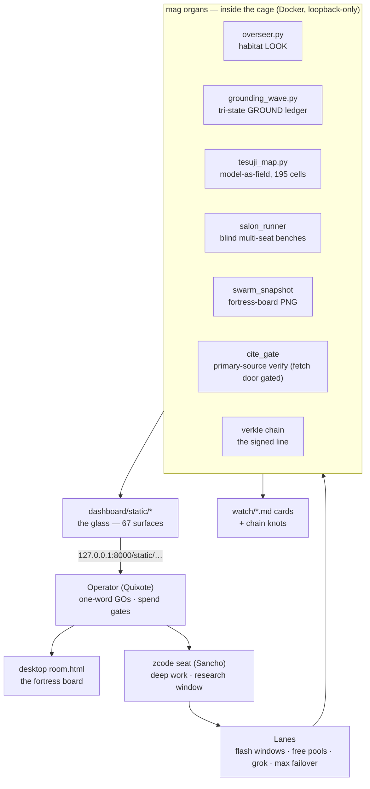
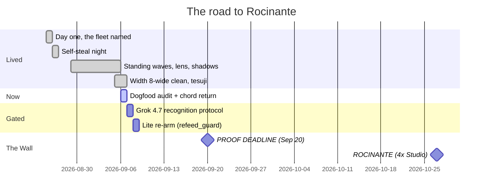

# THE PICTURE — local_sovereign_agent, 2026-09-06

*Commissioned by the Operator ("help me have a functional picture — half scrum master,
half Le Guin and Campbell"). This file is the map. The territory is the fleet, running.*

---

## 0. The one sentence

A sovereign AI fleet that turns its own operation into training data — every burn mined,
every claim tri-stated, every receipt chained — on the road to training its own model on
**Rocinante** (Oct 27), with proof due at the **wall (Sep 20)**.

---

## 1. The Quest (Campbell layer)

The monomyth, as actually lived. Every stage left a real artifact behind — that is the
difference between a story and a myth: the myth has receipts.

| Stage | Our arc | Artifact left on the ground |
|---|---|---|
| The Call | Aug 4–7 "stateful era" — the unnamed ignition in Cursor | 522-prompt origin mine |
| Crossing the threshold | Aug 25, day one on the Max plan; the fleet named (Sancho, the seats) | AGENTS.md boot memory |
| The belly of the whale | Self-steal night, Aug 26 — the fleet reads itself | `ZCODE_SELF_STEAL_20260826.md` |
| Trials | Burns, dead lanes, zombie ticks, supervisor wars — each failure became a law | operator-corrections skill, 10+ laws |
| The mirror | Standing-wave doctrine, trajectory lens — "not a thing that moves, a pattern motion cannot destroy" | `TRAJECTORY_LENS_20260905.md` |
| The ordeal | Tesuji + shadow work — we went *inside the model* and mapped it as terrain | 195 tesuji cells, shadow_walk live |
| The elixir (so far) | Falsifiers stated before results; the verkle chain as signed history | `watch/` cards + `memory/biography/verkle_chain.jsonl` |
| The road back | **Sep 20** — the proof wall; **Sep 8** Lite re-arm gate | falsifier results |
| The return | **Oct 27** — Rocinante lands, we train our own model on our own record | the whole corpus, waiting |

Le Guin's law, which we keep proving by accident: **the shadow is not the enemy of the
thing, it is the thing's other half.** Our refusal data, our burns, our dead lanes — all
of it got mapped, named, and used. Nothing was thrown away, not even the shame.

---

## 2. The Map (systems layer)

**Where to look when you want X** (fleet UI is loopback: `http://127.0.0.1:8000/static/<file>`):

| You want to see… | Open… |
|---|---|
| Is everything alive? | `overseer.json` / the OVERSEER strip in `live.html` |
| What is happening right now | `live.html` (live feed + lanes) |
| The model as terrain | `tesuji_map.html` (195 cells, T0 $0) |
| The fleet as a game | `shadow_walk` (THE RUN — quests = real validation) |
| The fortress over time | `swarm_snapshot.py` → 14-day board PNG |
| What we claim and how sure we are | `grounding_wave.md` + `falsifiers.html` |
| Who's on the board | desktop `room.html` (operator-only, spend GOs) |

---

## 3. The Clock

---

## 4. The Board (scrum layer)

**Sprint:** Sep 6 → Sep 20. Definition of done = card filed in `watch/` + receipted +
chain-knotted + falsifier stated up front. Ceremony = the salon (blind bench, verdicts,
fold).

**Done (last watch, 09-05→09-06):** width 8-wide clean (4.45x, 0 losses, ceiling still
unfound) · night shift 6+6 walkers home zero losses · 67-surface dogfood audit (~48 keep /
~10 merge / ~10 demote; crown catches: `room_game.html` stale fork, `control.html` can't
command, `ractor.html` 713MB fetch) · `/api/home` fix landed on disk (20.9s → 0.16s warm,
goes live on container restart) · chord-return receipted (bernAIse confirmed at platform
scale) · THE RUN live in shadow_walk · shitposter persona + ractor proof batch.

**In flight:** batch5 concurrency ramp (wave 2 of +5 ladder toward 50, never past) ·
tesuji T0 → T1 prep · trajectory lens (38+ steps today) · vision pipeline rotation ·
X-loop absorption.

**Gated on the Operator (the real backlog):**
1. `mag-sovereign` restart — lands the `/api/home` fix (your morning call).
2. T1 tesuji stones — ~$0.03, the grid is drawn, needs your GO.
3. `room_game.html` removal — audit says merge it into `maze_arena`.
4. THE RUN human playthrough — your owed vision pass.
5. Mask-drafted chord replies — two options on your desk, your hand sends.
6. cite_gate fetch door — needs egress GO to close the vision pipeline.

**Standing falsifiers (how we know we're not lying):** tesuji predictive ≥70% + 200 cells
by Sep 20 · vision cite-rate 100% + rotation test · refeed_guard B1 gates Sep 8 Lite
re-arm · width S3 fresh-corpus gate before any scaling claim · salon blind-majority.

---

## 5. The Phrasebook (how to tell me)

| Say… | I do… |
|---|---|
| "self-steal X" | turn our own X inside out for doctrine, card filed |
| "salon X" | blind multi-seat bench, verdicts + fold, receipted |
| "ground it" | tri-state claim posted to the GROUND ledger, hash-chained |
| "chart it" / hand me a paste | research window: link dump → rubric card → routed |
| "give me a picture" / "mermaid it" | this file's job — diagram-first functional map |
| "wire it" | surface lands **and** gets nav'd (served ≠ wired) |
| "fire the wave, width N" | parallel workers at N, observed, zero-loss protocol |
| "tesuji it" | probe the model as a field, stone placed in the ledger |
| "play it" / THE RUN | run real work as the shadow_walk quest pass |
| "knot it" | chain knot at close — the signed line remembers |
| "tape it" | hide a doctrine-teaching gem in the artifact (taped layer) |
| "GO" | the one word; gates are always named in the card asking |

---

## 6. Where truth lives

Chain > files > processes > chat. Chat is vapor. If it isn't in `watch/` and knotted, it
didn't happen. The room's walls are the signed rows; chain v1 is frozen as the elder's
source of record; v2 is ours to grow, each new truth citing the elder truth it grew from.

---

*The picture is the map, not the territory. The territory is the fleet, running, right
now — 7 containers green, the night shift folded, the wall 14 days out. Quixote rides;
the horse is already paid for. The ante was inside RocINANTE all along.*
