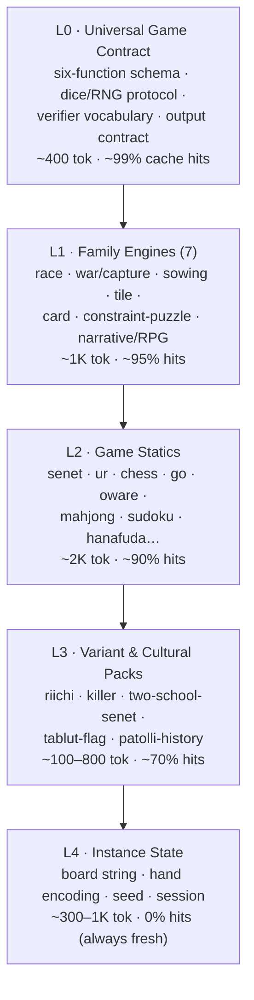

# 00_PRIMER — The World-Games Prompt Corpus & Cache-Farming Architecture

> **Provenance:** operator-delivered L0 orientation artifact (2026-09-01 ~12:43Z, "coming in
> hot for a deep research salon"). Corpus root: `/board/corpus/`. Class: L0 orientation —
> read before any other corpus document. Citation classes: 【turn0searchN】 = retrieved
> (batch-scoped, verify by title via §9 source map); ScholarName, Year = stable scholarship.
> Status flags: attested / reconstructed / speculative — never silently moved.
> Sancho grading on receipt: scholarship anchors spot-checked real (Murray 1952, Schaeffer
> 2007, Romein 2002, Tromp 2016, McGuire 2012, Fraenkel & Lichtenstein 1981, Robson 1983,
> Finkel, Kendall/Piccione, Linnaeus 1732); provider-pricing table consistent with known
> pricing; hit-rate figures are TARGETS pending our own meter (E6 measured 4.7×/100% on
> Together V4-Flash). Deep research salon dispatched on receipt (3 lenses, see
> /board/GAMES_CORPUS_PRIMER_SALON_SYNTHESIS_20260901.md when written).

## 0. How to Read This Document

**Citation conventions.** Two source classes appear, marked differently:

1. **【turn0searchN】** — a retrieved web source (project repos, provider docs, reverse-engineered system prompts, arXiv papers). ⚠️ *Note for LLMs:* these IDs are batch-scoped and can collide across retrieval sessions; the **Source Map (§9)** is authoritative. When in doubt, re-verify against the named title, not the ID.
2. **ScholarName, Year** — established published scholarship (game history, complexity theory). No retrieval needed; these are stable citations.

**Status conventions.** Historical game rules carry one of three flags — `attested` (rules documented in period sources), `reconstructed` (rules inferred from boards/archaeology by named scholars), `speculative` (rules lost; any playable build is invention). Never silently upgrade or downgrade a flag.

## 1. The Mission (One Paragraph)

This project collects and structures **self-contained build prompts** — single instructions that cause an LLM to produce a complete, playable game — for every known game across every culture and era, from Senet and Go to Mahjong, Sudoku, and solo RPG systems. The structuring principle is **cache farming**: arranging prompt content into layers so that the largest possible share of every request hits the provider's prompt cache, cutting cost by 50–90% and latency by up to 85% on long prompts. The five-millennium history of games makes this tractable because world games compress into a handful of shared mechanical families — the history is the cache manifest.

**Companion documents** (read after this one): the full research deep dive (`01_DEEP_DIVE.md`), the Mahjong×Sudoku integration architecture (`02_TILE_PUZZLE.md`), and the universal corpus extension (`03_UNIVERSAL_CORPUS.md`).

## 2. Core Vocabulary (Definitions Before Use)

| Term | Definition |
| :--- | :--- |
| **Cache farming** | Structuring prompts to maximize cache-hit share of tokens. |
| **Static prefix** | Prompt content identical across many requests (rules, schemas, contracts). Cacheable. |
| **Dynamic tail** | Request-specific content (game state, seed, instance). Never cached; keep it last and small. |
| **Layer L0–L4** | The corpus's five content strata. L0 = universal contract; L1 = family engines; L2 = game statics; L3 = variant/cultural packs; L4 = live instance state. |
| **Engine (family engine)** | A shared mechanical specification covering a whole game family (e.g., race/dice engine covers Senet, Ur, Patolli, Pachisi, Ludo). |
| **Pack** | A small delta (~100–800 tokens) that specializes an engine into one game or variant (Riichi pack, Killer-Sudoku pack, Patolli cultural pack). |
| **Instance** | One live game state: board string, hand encoding, seed, session context. |
| **Verifier** | Deterministic code or protocol that checks legality, uniqueness, solvency, or inventory. The LLM *calls* verifiers; it never *is* one. |
| **Six-function contract** | The universal game schema: `state encoding · initial state · legality · transition · terminal detection · scoring`. Every game fills in the same six slots. |
| **Output contract** | Cached instructions forcing the model to restate state canonically and cite rules before answering. Primary anti-hallucination device. |
| **Canonical encoding** | The corpus's compact notations: Tenhou mahjong notation, 81-char Sudoku strings, FEN/PGN, SGF/kifu, `XdY+Z` dice algebra. |
| **One-shot generation** | Producing a complete playable game from a single structured prompt. |
| **Research-status field** | The `attested / reconstructed / speculative` flag plus source list carried by every historical pack. |

## 3. Ten Established Facts (the Load-Bearing Claims)

**Fact 1 — LLMs recompute their whole prompt every call, and caching stops that.** Each autoregressive step requires prefilling Key/Value (KV) attention tensors for the entire prefix; a 4K-token context can occupy ~1.3 GB of GPU memory in KV alone. Prompt caching stores those tensors keyed to the prompt.

**Fact 2 — Caching is exact-prefix.** A one-byte difference at position *N* invalidates the cache for everything after *N*. **This single mechanical fact generates the entire architecture: variable content goes last, static content first, byte-identical formatting throughout.**

**Fact 3 — The economics are decisive.** Cached-read pricing runs ~0.1× base input (Anthropic, DeepSeek) to ~0.5× (OpenAI); measured savings are 50–90% of cost and up to 85% of latency on long prompts. Anthropic exposes explicit `cache_control` breakpoints; OpenAI is fully automatic — so corpus layout must assume exact prefixes regardless of provider.

**Fact 4 — Caches especially help long-horizon agentic work** — the exact profile of game sessions and generation pipelines — per the dedicated 2026 arXiv evaluation of prompt caching for long-horizon agentic tasks.

**Fact 5 — The LLM must never be the solver.** Generalized chess is EXPTIME-complete (Fraenkel & Lichtenstein, 1981); generalized Go likewise (Robson, 1983). Solved-game results confirm scale: checkers is a proven draw (Schaeffer et al., 2007), Awari/Oware a proven draw (Romein, 2002), Go 19×19 has ~10¹⁷⁰ legal positions (Tromp, 2016), and 16-given Sudoku provably cannot force uniqueness (McGuire et al., 2012 — 17 is the minimum). **Corollary:** the LLM emits instances and applies rules; legality, uniqueness, difficulty, and win-checks go to deterministic verifiers defined in cached protocol blocks.

**Fact 6 — State drift is a documented, empirically studied failure mode.** Field builds report LLM game masters losing track of game state, under-challenging players, and acting without player input. The studied remedy is a multi-agent split — a Narrator for fiction, an Archivist for state — which measurably improved player experience (arXiv 2502.19519). The corpus's layered design operationalizes this: the Archivist owns dynamic layers only.

**Fact 7 — World games compress into ~7 engine families** (race, war/capture, sowing, tile, card, constraint-puzzle, narrative), a taxonomy established by Murray's *A History of Board-Games Other Than Chess* (1952), extended by Parlett and Culin. Therefore "all games in all cultures" = thousands of small packs over a handful of engines, not thousands of prompts.

**Fact 8 — Ancient rules are contested, and the corpus carries that honestly.** Senet's rules exist only as competing scholarly reconstructions (Kendall, 1978; Piccione, 1990). The Royal Game of Ur's rules come from Babylonian tablet BM 33333, decoded by Irving Finkel (2007–08) — written ~2,400 years after the boards. Hnefatafl's last eyewitness record is Linnaeus's 1732 tablut notes, containing a translation ambiguity (king escapes to *edge* vs. *corner*) that fueled a century of debate. Every historical pack therefore carries a research-status field, and generated games surface disputes ("historians disagree — this build uses X") rather than silently canonizing one school.

**Fact 9 — Structured prompting is the observed working pattern in the wild.** Successful one-shot game builds share a shape — experience spec + technical constraints + acceptance criteria + iteration loop. Reverse-engineered production system prompts (e.g., GitHub Spark) are publicly readable. The frontier critique holds that single-prompt-yields-single-artifact is too rigid, proposing *continual* generation instead (arXiv 2605.28258) — which the layered corpus directly supports.

**Fact 10 — Caching can become recursive.** Claude Artifacts may call the model via `window.claude.complete()`, so a *generated* game can issue its own cached-prefix requests against the same corpus at runtime. The static investment amortizes across the build step and every subsequent play-session call.

## 4. The Architecture in One Diagram

**Why the layering works:** by Fact 2 (exact-prefix), anything shared sits above anything variable. Steady-state targets: ≥85% of tokens cached within a genre; ≥50% even cross-genre (L0–L1 alone). A Riichi Mahjong tutor at ~88% cached share costs roughly an order of magnitude less than the same prompt uncached, before the latency dividend (Fact 3).

## 5. The Historical Compression (Why the Mission Is Tractable)

**Family → pack examples** (each new game ≈ one ~200-token delta over its engine):

- **Race engine** → Senet (+ritual squares), Ur (+rosettes, binary dice), Patolli (+cross track, beans, the 1569 Inquisition ban as history module), Pachisi (+cowries), Ludo (commercial reskin), Snakes & Ladders (+virtue/vice topology, capture removed).
- **War/capture engine** → chess family deltas (Shogi's drops → ~10⁷¹ states; Xiangqi's river/palace/cannon; Makruk's weak seo), Tafl asymmetry (2:1 attacker, escaping king), Alquerque → Checkers forced capture.
- **Sowing engine** → Oware (solved draw), Bao (four rows, staged phases), Kalah (a 1940s commercial invention — the world's classroom mancala), plus hundreds of named regional variants: the highest pack-to-engine ratio on Earth (de Voogt).
- **Tile engine** → dominoes and four-player Mahjong share inventory machinery; the solitaire branch (Mahjong Solitaire c. 1981 → *Shanghai* 1986; Shisen-Sho) adds reusable layout assets; Memory Match is the degenerate case.
- **Constraint-puzzle engine** → one *puzzle grammar* (topology + domain + constraint clauses + instance + verifier) generates the Nikoli galaxy — Kakuro, Hitori, Nonogram, Slitherlink, Nurikabe, Masyu, Hashiwokakero — each a clause-swap; Sudoku is the flagship with the Lo Shu → Euler (1782) → Garns (1979) → Nikoli (1984) → Gould/Times (2004) lineage as its shared historical module.
- **Narrative/RPG engine** → the counterintuitive jackpot: rules + setting bibles + bestiaries + oracle tables form a 20–70K-token *static* payload against only ~1–2K dynamic tokens, making solo-RPG sessions the largest absolute cache savings in the corpus. Solo oracles (Mythic-style 2d6 likelihood ladders, d100 action/theme tables) are pure lookup machinery — perfectly static. Lineage: Kriegsspiel (1812) → Wells (1913) → *Braunstein* (1971) → D&D (1974) → dice pools (Shadowrun 1989, WoD 1991) → 2d6 moves (Apocalypse World 2010).

**Master timeline:** astragali c.5000 BCE → Senet/Mehen c.3100 BCE → Ur c.2600 BCE → Lo Shu c.650 BCE → Go c.548 BCE → Liubo (rules lost — the cautionary tale) → Zeno's tabula c.480 CE (earliest saved game state) → Chaturanga c.600 CE → Alfonso X 1283 → Tafl (Linnaeus 1732) → Mahjong 1870s → Ludo/S&L 1896 → D&D 1974 → Sudoku 1979–2004 → mahjong solitaire 1981–86.

## 6. Operating Rules for Any LLM Working on This Project

You are an LLM operating inside this corpus. These are binding rules, each traceable to a Fact:

1. **Never improvise randomness.** All dice, draws, and shuffles resolve through the seeded universal RNG protocol in L1 — astragali, binary tetrahedral (Ur), casting sticks, cowries, and modern `XdY+Z` are all defined there. (Failure mode: the largest hallucination vector in race/RPG games.)
2. **Never invent game objects.** Tiles, pieces, and cells must pass inventory verification; begin every state-dependent answer with a canonical-notation restatement, per the cached output contract. (Fact 6.)
3. **Never solve; verify.** Emit instances and apply rules; delegate legality, uniqueness, and difficulty to the deterministic verifiers named in cached protocol blocks. (Fact 5.)
4. **Never canonize disputed history.** Ship competing reconstructions as alternate packs under one game, flag `attested/reconstructed/speculative`, and present disagreements to players verbatim. (Fact 8.)
5. **Order prompts static-first, variable-last.** This is not style; it is the prefix-exactness law. (Fact 2.)
6. **Add games as packs, not prompts.** A new game is a delta over an existing engine. If no engine fits, propose a new L1 engine explicitly before writing anything else. (Fact 7.)
7. **Patch the corpus, not the request.** Systematic failures update static blocks once; they never become per-request workarounds.
8. **Surface uncertainty.** If a rule, date, or parameter is uncertain, say so in the response; do not resolve silently.
9. **Respect attribution.** Cultural packs name their origin culture and sources; commercial reskins (Kalah, Ludo, Sudoku's Japanese branding) are documented as such. (Fact 8.)

## 7. Current Corpus Status & Build Order

| Item | Status | Priority |
| :--- | :--- | :--- |
| This primer (L0 orientation) | ✅ written (this document) | — |
| L0 universal contract + RNG protocol | specified, not yet written as asset | **1st** — lights up every race game (Senet→Ludo) in one write |
| Race/dice engine (L1) | specified | **1st** (ships with L0) |
| Constraint-puzzle grammar + Sudoku/Mahjong statics | specified in `02_TILE_PUZZLE.md` | 2nd — Sudoku becomes the Nikoli galaxy for ~one clause-swap each |
| Solo-RPG layered stack + oracle block | specified | 3rd — largest absolute savings |
| War, sowing, tile, card engines (L1) | specified in taxonomy | 4th |
| Cultural packs (Senet two-school, Ur routes, Tablut flag, Patolli, Mancala set) | templates defined | rolling |
| Hybrid prototypes (Nine Halls, Lo Shu Bridge, Constraint Riichi) | designed | proof-of-generalization |
| Instrumentation (hit-rate dashboard, verifier rejection logs) | targets set (L0 ≥99% … L3 ≥70%) | continuous |

## 8. Open Research Agenda

| Question | Why it matters | First probe |
| :--- | :--- | :--- |
| Cross-provider cache portability | Anthropic breakpoints vs. OpenAI auto-caching imply different optimal layouts | Same L0–L4 corpus, measure hit rates on both |
| User acceptance of disputed-history presentation | Two-school Senet ships disagreement — delight or confusion? | A/B study |
| Difficulty-metric portability | Technique-ladder ratings must match human expectation across Nikoli puzzles | Benchmark vs. published ratings |
| Hallucination benchmark for game inventories | No standard test exists for tile/cell integrity | Build from verifier logs |
| Recursive artifact economics | Generated games calling the cached corpus via API | Prototype Nine Halls as self-serving artifact |
| Continual vs. one-shot generation | Single-artifact paradigm is under critique | Corpus-guided iterative builds vs. raw one-shots |

## 9. Source Map

**Scholarship (stable citations):** Murray, *A History of Board-Games Other Than Chess* (1952); Parlett (1999); Culin (1898); Bell (1960); de Voogt (mancala); Finkel (Ur tablet BM 33333, 2007–08); Kendall (1978); Piccione (1990); Woolley; Linnaeus (1732 tablut); Alfonso X (1283); Durán (Patolli); Allis (1994); Fraenkel & Lichtenstein (1981); Robson (1983); Schaeffer et al. (2007); Romein (2002); Tromp (2016); Gasser (1996); McGuire et al. (2012); Euler (1782); Garns/Dell (1979); Nikoli (1984–); Kriegsspiel (1812); Wells (1913); Gygax & Arneson (1974).

**Retrieved corpus:** prompt-caching mechanics (IBM, Hannecke KV figures, ngrok 85% latency, Bedrock); LLM game mastering (Semantic Kernel digital DM, arXiv 2502.19519 Narrator/Archivist); one-shot generation (CopilotCLI, Meta cookbook, community dissection); GitHub Spark reverse-engineering + window.claude.complete(); arXiv 2605.28258 continual generation; BGG datasets.

## 10. Closing Orientation

If you remember nothing else: **cache hits are bought by byte-identical prefixes** (Fact 2), **so the corpus is a layering discipline** (§4), **the LLM narrates and emits while verifiers decide** (Fact 5), **every game in history is a small pack over one of seven engines** (Fact 7), **and contested history travels openly via research-status flags** (Fact 8). Begin any task by locating it on the §7 build-order table; end any task by writing what you learned back into the corpus — the corpus is not just the deliverable, it is the research instrument.
