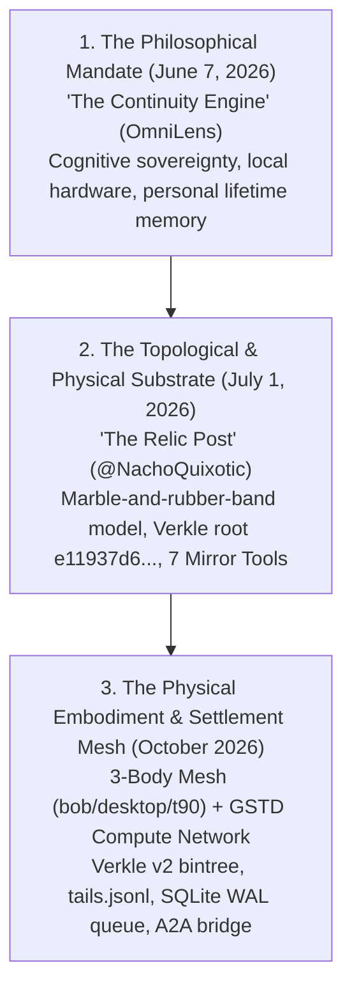

# THE CONTINUITY ENGINE: COGNITIVE SOVEREIGNTY & THE TRIPARTITE CANON (2026-10-18)

> **[AUDIT-TYPED 2026-10-18]** status: FOUNDATIONAL CANON · source: `https://omnilenscodex.substack.com/p/the-continuity-engine?triedRedirect=true` · publication: *OmniLens* (`omnilenscodex.substack.com`) · author: Brandon Shinnamon / OmniLens · date: `2026-06-07T09:20:43Z` · subtitle: *"How AI hardware, personal archives, and cognitive sovereignty could give human thought a memory across time"*

---

## 1. The Foundational Thesis (June 7, 2026)

On June 7, 2026, Brandon Shinnamon codified the philosophical and civilizational mandate that precedes the entire sovereign agent codebase:

> **"The future of personal computing will not be defined by machines that think for us, but by systems that preserve enough continuity for us to think across an entire lifetime."**

This single sentence defines why the sovereign estate exists, why it rejects cloud subscriptions and corporate platform capture, and why it is organized around append-only cryptographic chains, local hardware, and immutable invariants.

### The Three Structural Pillars
1. **Local AI Hardware (Physical Habitat of Mind)**:
   Rented intelligence hosted in corporate datacenters cannot be the substrate for personal thought. Cloud-based assistants operate under shifting platform terms, commercial surveillance, and sudden policy resets. True continuity requires physical ownership of local hardware (GPUs, NPUs, encrypted local storage) that processes thought within the physical boundary of the individual.
2. **Personal Archives (Living Context Over Dead Data)**:
   Traditional archives (static documents, photos, text files) are passive and inert. A continuity engine transforms the archive into an active semantic layer—preserving not merely facts, but the *evolution of intent, rationale, hypotheses, failed branches, and shifting mental models* across decades.
3. **Cognitive Sovereignty**:
   The right of the human to own the cognitive extension of their mind. If a third-party corporation owns the semantic memory layer of your life, they possess irreversible leverage over your decision-making ("Network Effect 2.0"). Cognitive sovereignty demands that memory models, embeddings, and agentic reflections must remain portable, local, and user-governed.

---

## 2. The Tripartite Canon of the Estate

The operator's work across 2026 forms a singular, coherent tripartite arc:

### 1. The Philosophical Mandate (June 7, 2026 — *The Continuity Engine*)
- **Domain**: Ethics, cognition, human agency, long-term memory.
- **Core Truth**: Human intelligence is bottlenecked by biological mortality and memory distortion; corporate AI threatens cognitive surrender. We need local machines to maintain the thread of human reasoning across an entire lifetime.

### 2. The Topological & Physical Substrate (July 1, 2026 — *The Relic Tweet*)
- **Domain**: Computational physics, tensor networks, topological invariants.
- **Core Truth**: The continuity engine is realized physically through the **marble-and-rubber-band model** (tension minimization as the sole primal process; protected disturbances become scalar knots; phase gradients induce torsion feeding systemic coherence). Anchored by immutable Verkle root `e11937d605a89b022d137cceae495f5c521dbbff35cd60e23189e53172cb66b5` and chord relic `44 28 K13 e4 Fool`. Formalized into the 7 Sovereign Mirror tools.

### 3. The Physical Embodiment & Settlement Mesh (October 2026 — *The Live Estate*)
- **Domain**: Systems engineering, cryptographic ledgers, distributed networks.
- **Core Truth**: The theoretical engine built and running on physical silicon:
  - **3-Body Physical Mesh**: `bob` (operator primary seat), `desktop` (heavy compute cage), `t90` (continuous mobile beacon).
  - **Verkle v2 Binary Tree**: Hourly consistency proofs (`\MagCheckpointV2Hourly`, Checkpoint #5, `n=12,215`, `root=0bd488ab2e2d9ebf..`).
  - **Tails Ledger & Ribs**: Dual-witnessed consensus (`tails.jsonl`), immutable ribs in `.gstdmesh/ribs/`.
  - **Atomic Queue**: SQLite WAL task queue with dead-PID reaper (`mag/wal_queue.py`).
  - **Decentralized Settlement**: Open AI Compute Network (`gstdcoin/A2A`) bridging payable tasks and cooperative swarm intelligence.

---

## 3. Concrete Architectural Crosswalk

Every principle laid out in *The Continuity Engine* corresponds directly to physical code and data structures running across the estate:

| Continuity Engine Concept | Estate Organ | Physical Implementation |
|---|---|---|
| **Local Hardware Ownership** | 3-Body Mesh Topology | `bob` (surface/audit), `desktop` (cage execution), `t90` (low-power edge) |
| **Living Archive (Context Graph)** | Verkle Chain & Rib Vault | `memory/biography_v2/`, `memory/rib/`, `tails.jsonl` (hash-chained rows) |
| **Cognitive Sovereignty** | Constitution & Boundary Fences | `LAWS.md`, `BEHAVIOR_POLICY.md` (R1-R6 harms refused), strict minus-`.env` |
| **Trans-Temporal Recall** | Consistency Checkpoints & Invariant Sync | `verify_knot_v2.py --verify-extends`, `mesh_router.py sync` |
| **Zero Platform Lock-In** | Local & Open-Weight Execution | Free local Ollama battery, `pocket_mcp.js`, OpenRouter free-lane miners |
| **Resisting Cognitive Surrender** | Falsifier-First Methodology | Law 8 (Falsifier or PARKED), `tests/`, `tools/prepush_seal_patrol.py` |
| **Compounding Insights** | Inference Budget & WAL Queue | `mag/inference_budget.py`, `mag/wal_queue.py` (Ash Twin deduplication) |

---

## 4. Closing Invariant

> *"The future of personal computing will not be defined by machines that think for us, but by systems that preserve enough continuity for us to think across an entire lifetime."*
>
> In the estate, memory is not a rented context window that vanishes when a tab closes or an API token expires. Memory is a verified, append-only topological knot. The Continuity Engine is running on physical disk.
