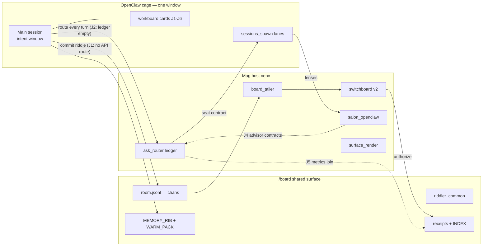

# FRONT-DOOR MISSING JOINS — deep self-steal map (2026-09-01)

`schema: archivist.artifact.v1` · route: primary-source/mechanical (ls/grep/fetch this session) · deref: HIT (SELF_STEAL_REBUILD_RETEST_SALON_20260831 + FLEET_STRUCTURE_20260901 absorbed, not duplicated)

## Question
Deep self-steal of all missing front-door items (main → intent → chans commit → route → advisors → salon → receipts), and how to display them via existing display tools.

## Verified EXISTS (bytes on disk, this session)
| Item | Evidence |
|---|---|
| Chans board | /board/room.jsonl (1,183,908B) |
| Riddler bus + booth | /board/riddler_common.jsonl (72,556B) · primer_booth_public.json |
| Memory-RIB spine | MEMORY_RIB_CONCEPTS.json · MEMORY_RIB.jsonl · WARM_PACK.json |
| Receipt ledgers | ARCHIVIST_RECEIPTS.jsonl (91,564B) · INBOX_LINKS.jsonl · inbox/INDEX.json |
| Organs | ask_router.py · board_tailer.py · salon_openclaw.py · session_bridge.py · switchboard.py + switchboard_v2.py · swarm_cycle.py · riddler×7 · surface_render.py · read_archive.py · steal_pack.py · research_fold.py · fireball_cycle.py · frontier_salon.py |
| Routing ledger | /mag/memory/runs/ask_router/ledger.jsonl (live: 1 first-light outcome, deepseek ok 3.6s $0) |
| Economist output | ECONOMIST_ROUTE_20260901.md · ECONOMIST_SPEND_AUDIT_20260901.md |
| Fleet doctrine | FLEET_STRUCTURE_20260901.md · LANE_SLOT_MAP_20260901.md |

## MISSING JOINS (the gap is joins, not organs — RIB verdict confirmed)
| # | Join | Evidence (fetched) | Compose fix (no new organs) |
|---|---|---|---|
| J1 | Cage → Mag API (127.0.0.1:8765) dead | node fetch: UNREACHABLE 4s timeout, this session | Chan commits from cage go FILE-spool → board_tailer/classifier drains host-side; or host opens API lane to cage |
| J2 | ask_router traffic ≈ 0 | ledger.jsonl = 1 line | Front-door loop routes every turn via ask_router (the loop itself feeds the ledger) |
| J3 | Legacy direct board writes survive | swarm_tools.py:329 flags "legacy direct write; route through switchboard.propose for any effect" | Host patch retires legacy path → `python -m mag.openclaw_patches apply` |
| J4 | No advisor send-contracts | seat_corpus has lane contracts, no Economist/Archivist persona contracts; Economist already emitting receipts | Add advisor entries via /patches (persona = job contract per RIB law 10) |
| J5 | No ladder-metrics join | decode receipts, ask ledger, salon receipts live in separate stores | One metrics join line per front-door cycle: decode-pass rate, routing hit-rate, salon yield (better-by-default ladder) |
| J6 | front-door skill pending | proposal front-door-20260901-60f1429405, unapplied, acceptance test unrun | Operator applies after WikiSkill gate runs |

## Display routing (compose existing display organs)
| Tool | Status | Use |
|---|---|---|
| Mermaid via host (surface_render / dashboard hypervisor) | LIVE host-side; cage cannot reach 8765 (J1) | Render the graph below host-side |
| Control UI chat mermaid | renders in this window | Graph in reply |
| Workboard cards | LIVE | J1–J6 filed as cards (visible, dispatchable) |
| Notion | **CORRECTED 02:35Z — EXISTS.** /board/notion_bridge.py (sha 5b1f8eda0517): desktop-seat mailbox bridge, mirrors zcode_bridge, no token; API path mag/notion_api.py (needs NOTION_API_KEY). Initial verdict came from TOOLS.md inventory without grepping /board — reach failure, receipted | Seat surface for Notion-side work; API path gated on operator key |

## Fetch log
- /board/* ls+wc → ok · /mag/mag module ls → ok · ledger tail → ok · swarm_tools.py grep → ok · node fetch 8765 → UNREACHABLE (recorded) · INDEX read → ok · SELF_STEAL RIB read(60) → ok · FLEET_STRUCTURE read(60) → ok · /board root ls (correction pass) → ok · notion_bridge.py head(15) → ok · POST_FORMAT_SPEC.md head(25) → ok

## Pipeline graph (solid = verified bytes, dashed = missing join)

