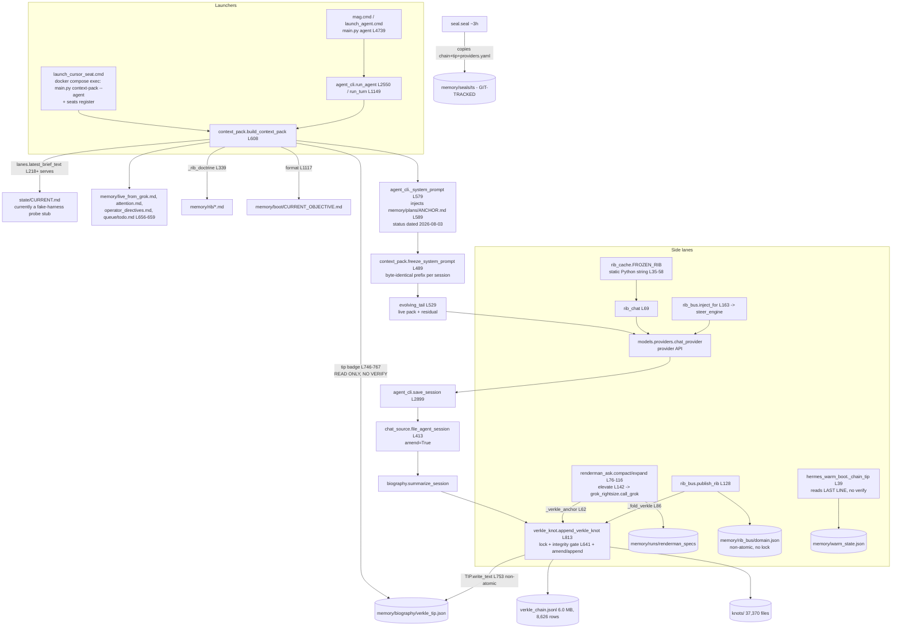

# MAG SYSTEMS DEEP ANALYSIS: local_sovereign_agent (2026-09-30)

Scope: read-only analysis of `C:\Users\foste\Documents\projects\local_sovereign_agent` on DESKTOP-7C70KSC, done 2026-09-30 between 06:38 and about 07:15 ET.
Method: PowerShell and git reads, plus Mag venv (`.venv\Scripts\python.exe`, 3.11.15) runs with `PYTHONDONTWRITEBYTECODE=1`. Every helper script lived outside the estate, in `C:\Users\foste\agent-tools\`. I made no writes in the estate and no paid calls, and I didn't touch the tip, CURRENT, MANIFEST or seal files. `git status --porcelain` showed 44 lines both before and after the health-check script ran.
**The estate is live.** Daemons appended about 6 chain leaves during the analysis (tip went from n_leaves 8,620 to 8,626), and HEAD moved from `e499972b0` to `7f3ed70e8` because of the operator's own commits. Numbers are snapshots from that window.
Labels: `[UNBOUND]` means not verified. "L" means line number.

---

## TL;DR (10 lines)

1. **What works:** the hash chain is internally consistent (8,626 leaves, `_verify_chain_consistent` PASS in 2.0 s), the 3-hourly seal verifies, the party subchain verifies (831 rows), 20/20 key modules import, 3,192 tests collect with 0 errors, and pip check is clean.
2. **Core design fact:** a seat does NOT launch *from* the Verkle. The tip is read unverified as a display badge (`context_pack.py` L746-767). The actual continuity is plain files: `state/CURRENT.md`, `memory/rib/*.md`, `operator_directives.md`, `ANCHOR.md`, `live_from_grok.md` and `todo.md`. None of them is bound to the tip.
3. **"Verkle" is a binary SHA-256 Merkle list** (`verkle_knot.py` L148-159). It is amended in place (2,821/8,626 rows, 33%) and compacted (6.64 MB down to 5.54 MB between seals). It is not append-only, and the "proof/signature" is an unkeyed sha256 (`proof.py` L50-59).
4. **BROKEN, security:** 7 live API keys from `.env` are committed in the tracked file `memory/trajectory/steps.jsonl` (in HEAD, 64 commits since 2026-09-14, key names in §7). That puts them in git history and in the backup repo.
5. **BROKEN, fresh setup:** `requirements.txt` has committed merge-conflict markers (L1/L17/L29, HEAD). `scripts/ensure_venv.ps1` runs `pip install -r` on it, so a cold bootstrap fails.
6. **BROKEN, boot truth:** `state/CURRENT.md` (the "live truth" served as the brief by `lanes.py` L218+) currently holds a fake-harness probe stub. `memory/plans/ANCHOR.md` (status dated 2026-08-03) is auto-injected into every agent session (`agent_cli.py` L589).
7. **Backup posture:** the only git remote is a bare repo on the same disk. The encrypted essentials pack (09-26, 1.7 GB, stored inside the estate) doesn't list `memory/biography` (chain and knots). So the "truth" has no confirmed off-machine copy.
8. **Rot and growth:** the estate is 112.6 GB and 5.18 M files. `.mimosa` alone is 61 GB and 4.4 M files, `.git` is 10.4 GB, `watch/` 7.2 GB, 372 chain rows point at missing knot files, the ratchet FAILs (13 new debt items), and there are 123 hardcoded `C:\Users\foste` paths plus junk dirs (`%TEMP%`, `%CD%`, `nul`) left by unexpanded env vars.
9. **Top 5 fixes (impact/effort):** (1) rotate the 7 keys, untrack `steps.jsonl` and redact in the trajectory hook; (2) fix `requirements.txt` and add a lock file; (3) verify the tip at boot and make every tip write atomic; (4) back up biography, chain and knots offsite and test a restore; (5) stop probes overwriting `state/CURRENT.md`, and refresh or retire `ANCHOR.md` injection.
10. **Health checks:** 10 PASS / 8 FAIL / 3 WARN / 3 not run (they mutate). Table in §4.

---

## 1. Estate map

### 1.1 Size and shape (python `os.scandir` walk, read-only)
| Dir | Size | Files | .py | Note |
|---|---|---|---|---|
| `.mimosa` | 61.1 GB | 4,441,958 | 0 | gitignored (`.gitignore` L191); subdirs history/hook-state/hook-status/reports/finding-ledger, all written at 07:02 today |
| `.git` | 10.4 GB | 12,475 | | pack 6.27 GiB, 3.0 GiB loose, **422.5 MiB garbage (4 tmp_pack files)** (`git count-objects -vH`) |
| `corpus` | 8.0 GB | 75,591 | 3,402 | |
| `watch` | 7.2 GB | 20,907 | 517 | `watch/inbox` 6.1 GB and 13,488 files; 12,841 tracked |
| `mine` | 5.7 GB | 103,035 | 15,800 | |
| `memory` | 5.4 GB | 392,181 | 387 | 137 subdirs; 24,643 tracked files |
| `dashboard` | 5.0 GB | 602 | 13 | |
| `attic` | 3.1 GB | 144 | 105 | |
| `.venv` | 1.7 GB | 60,517 | | 492 site-packages |
| `logs` | 1.7 GB | 5,783 | | |
| `mag` (core) | 43.5 MB | 2,967 | 1,065 | 1,078 top-level files; many `__pycache__` for cp311/312/314 |
| **Total (dirs)** | **112.6 GB** | **5,178,460** | | |

- Top-level: 791 files (225 .json, 204 .txt, 123 .html, 79 .py, 43 .md, 40 .cmd) and about 110 dirs. The root holds corpus dumps (for example `sabbatean.pdf` 25.9 MB and `matthew_export.tar.gz` 20.4 MB, both tracked).
- Tracked in git: 49,222 files. 1,065 are `mag/*.py`. 24,643 sit under `memory/`, even though the `.gitignore` header says "Live memory ... memory stays local".
- Source: 1,469 .py files and 353,789 lines across mag/tools/scripts/models/server/backend and root. Largest: `main.py` (237,897 B, 5,460 lines), `mag/game_campaign.py` 228 KB, `mag/ghost.py` 186 KB, `mag/agent_cli.py` 128 KB.

### 1.2 Entry points
- `mag.cmd` runs `.venv\Scripts\python.exe main.py %*`, and exits 1 if the venv is missing (`mag.cmd` L4-8). `mag.ps1` forwards to `mag.cmd`.
- `main.py` is the argparse monolith (215 subcommand/verkle/context-pack references). `context-pack` handler: L3511-3551. `agent` handler: L4739.
- `boot_mag.cmd` runs `main.py power start --browser` (backend :8000, dashboard :8765).
- There are 16 `launch_*.cmd` files. Example: `launch_cursor_seat.cmd` runs `docker compose exec mag python main.py context-pack --agent` and then `seats register`. `launch_agent.cmd` runs `main.py agent --provider deepseek`.
- `mag_launch.py` (25.9 KB) is the supervisor roster; RUNNING.md says the lane_scheduler lives there.
- There are 15 Windows scheduled tasks `Mag*`, 13 Ready and 2 Disabled (`Get-ScheduledTask`).

### 1.3 Git (read-only)
- Branch `mag/run-beta1-factory-build-audi-20260806T231709Z`. All work since 08-06 lives on a run-named branch. `main` and `master` exist locally; there are 37 branches and 6 worktrees (4 detached codex worktrees at `a4733004a`).
- 802+ commits. First commit 2026-08-04, "clean publish baseline".
- Remote: only `local = C:\Users\foste\Documents\projects\Mag-backup.git` (same disk). 61 commits (since 2026-09-29) are not on any backup ref.
- Working tree: 18 modified at start, all runtime ledgers (`memory/*`, `queue/lanes/builder/*`, `training/*.jsonl`, `watch/inbox/*`). Untracked includes `nul` (a Windows reserved-name file left by a bash redirect) and new inbox files.
- `docs` mention `github.com/NachoBusiness17/Mag`, but it is not configured as a remote. Public fetch returns 404 (private or absent) `[UNBOUND]`.

---

## 2. Launch path: what "launch from the Verkle" actually does

### 2.1 Diagram

### 2.2 Trace with receipts
1. **Tip.** `memory/biography/verkle_tip.json` is written by `verkle_knot._append_verkle_knot_unlocked`. It contains `{root, n_leaves, last_filename, last_leaf_hash, last_session_id, updated_minute}` (`_tip_for_tail` L559-572).
2. **"Manifest."** No module binds a manifest to the tip at launch.
   - `state/manifest_anchor.json` is dated 2026-08-24 10:13. Every seal since then has copied the same 477-byte file, so the anchor hasn't moved in 5 weeks.
   - `seed/MANIFEST.sha256` belongs to the separate seed package.
   - The AGENTS.md L28 formula "frozen RIB = system+bootloader+manifest+verkle tip" is not what `rib_cache.FROZEN_RIB` implements. `FROZEN_RIB` is a hardcoded doctrine string (`rib_cache.py` L35-58) with no tip, manifest or bootloader content.
3. **RIB mount.** Three separate "RIB" surfaces exist, and none is gated by the tip:
   - `memory/rib/*.md` is loaded by `context_pack._rib_doctrine` (L339-376).
   - `memory/rib_bus/<domain>.json` is loaded by `rib_bus.mount` (L155-160). Its docstring says "Memory is the source of truth ... the verkle knot + bus publish are the durable/realtime projection" (L22-23), so the chain is the projection, not the source.
   - `rib_cache.FROZEN_RIB` is a static string.
4. **Prompt pack.** `build_context_pack` (L608+) assembles brief, live, attention, directives, todo, doctrine, objective and a tip badge. `agent_cli.repack_messages` (L938-1024) freezes the stable body plus tool schemas (`freeze_system_prompt` L489-526), then appends `evolving_tail` (L529-562).
5. **Model call.** `models.providers.chat_provider` is called from agent_cli and `rib_cache.rib_chat` (L85-91). `renderman_ask.ask_grok_for_executor_spec` calls `mag.grok_rightsize.call_grok` (L131-137).
6. **Residual write-back.** `save_session` (L2899) goes to `file_agent_session(amend=True)` (chat_source L413-457), then `summarize_session`, then `append_verkle_knot`. Under `verkle_lock`, the append path does this:
   - verify gate (L641);
   - if the same session_id exists, **amend** by replacing the row and rewriting the whole chain via `_rewrite_chain` (L713-726);
   - otherwise append one line (L727-745);
   - write the tip (L753), then self-heal after a race (L766-794).

**Verdict:** "launch from a frozen Verkle tip" is true only as labelling. The tip is shown to the seat (`context_pack.py` L750-760, `format_context_pack_text` L1058-1063). No launch path verifies it: grep found no call to `_verify_chain_consistent` or `prove_latest` in context_pack, hermes_warm_boot or agent_cli boot. Nothing hashes the mounted RIB content against a chain leaf either. Verification happens only at **write** time (append gate). A seat started on a corrupted or forked chain gets a well-formed badge and no warning.

### 2.3 Defects on this path
- `hermes_warm_boot._chain_tip` (L39-59) reads the last chain line raw. It reports keys `leaves` and `tag`, which chain rows never carry (row schema at `verkle_knot.py` L700-712 and L736-739 uses `n_leaves`), so those fields are always empty. Its `--verify` flag (L101) only skips the write and verifies nothing.
- `hermes_warm_boot._deployments` hardcodes a Vercel URL (L70-72). `grok_warm_rib.warm_rib_text` hardcodes a knot id and root (L65), which are stale by construction.
- `mag/_warm_rib.py` is named like a module but is a script: it hardcodes `c:\Users\foste\...` (L3-4), writes `queue/handoff/zcode/RIB.md` and makes a metered call at import.
- `verkle_knot.py` L753 and L792 write the tip with plain `TIP.write_text`. The atomic `_write_tip_atomic` (L587-596) exists because "a torn tip write froze every chain append" (L375-377), yet it is only used in consolidate and repair. **The main append path is still non-atomic.**
- `renderman_ask._specs_dir` calls `mkdir` on use and swallows all errors (`_save_cached_spec` L54-59 `except: pass`). Elevation failures silently lose the cache.

---

## 3. Memory architecture

### 3.1 Layout (sizes are read-only counts)
| Path | Files | Size | Role / receipt |
|---|---|---|---|
| `memory/biography/verkle_chain.jsonl` | 1 | 6.0 MB | chain rows (`verkle_knot.py` L34) |
| `memory/biography/knots/` | 37,370 | | one leaf file per session plus 2 pointer files each (`by-session_`, `by-session_v2_`, L692-698) |
| `memory/biography/residual/` | 4,016 | 142.9 MB | residual DNA. Boot census is cached hourly because a full scan wedged boots at about 3.7k files (`context_pack.py` L565-605) |
| `memory/rib/` | 45 | 0.2 MB | doctrine RIBs (`_rib_doctrine`) |
| `memory/rib_bus/` | 51 | 0.7 MB | per-domain instruction store (`rib_bus.py` L48) |
| `memory/mycelium/` | 3 | 16 MB | graph snapshot and nodes. Tracked; contains token-shaped strings (§7) |
| `memory/plans/ANCHOR.md` | 1 | 2.5 KB | "auto-injected into every agent session", status block dated 2026-08-03 |
| `memory/seals/` | 403 | 206.6 MB | 20 seal dirs, **320 files git-tracked** |
| `memory/runs/` | 398 subdirs | | includes `file_dogfood/manifest.jsonl` **292 MB** and a full Chromium profile `host_browser/profile` |
| `memory/trajectory/steps.jsonl` | 1 | 34.9 MB | PostToolUse hook log. **Tracked; contains live secrets** |
| `watch/inbox/` | 13,488 | 6.1 GB | "durable write root" (AGENTS.md L14-20). `INDEX.json` is 610 KB. Holds the 1.7 GB essentials pack |
| `memory/runs/party_subchain/` | 2 | 0.5 MB | seat-to-seat chain |

### 3.2 How residuals are written and folded
- **Agent seat:** `save_session` (`agent_cli.py` L2899) then `file_agent_session(amend=True)` (`chat_source.py` L413). Every save of a known session is an **amend**, which rewrites the entire chain file under lock (`verkle_knot.py` L713-726). 2,821 of 8,626 rows (33%) carry `amended=true`.
- **rib_bus:** `publish_rib` (L128-152) writes the whole domain JSON (non-atomic `write_text` L81, no lock), then folds a knot with session_id `rib_bus_{domain}` (L92). Every new RIB in a domain **amends the same leaf**, so each publish triggers a full chain rewrite. `tension_index` is passed as a string (L99).
- **renderman:** only a successful grok elevation anchors a knot (`_verkle_anchor` L62-73). `compact` and `expand` are pure and deterministic; I checked this, the same goal gives the same rib_hash.
- **Compaction:** `verkle_compaction.py` exists. The seal copies show the chain shrank from 6.64 MB (seal 2026-09-26T09-03-57Z) to 5.54 MB (2026-09-29T03-04-07Z). History is rewritten, not appended.
- **Chain quality:**
  - 5,977 of 8,626 rows (69%) have an empty `dominant_theme`, mostly `memlang--*` (3,251) and `mag-agent-*` (1,068) sessions. The "behavioral geometry" in `verkle_rib.rib_points` (L60-81) therefore labels most points "untagged".
  - 618 rows carry `evidence_lost`.
  - **372 rows reference knot files that don't exist.**
- **Growth:** chain rows by `ts` month: Aug 3,920, Sep 4,706, about 150/day. Knot files: Aug 17,814, Sep 19,524.

### 3.3 Integrity model (honest version)
- The "Verkle" is a **binary SHA-256 Merkle tree over leaf hashes** (`_merkle_root` L148-159, "Merkle-Verkle hybrid ... IPA/KZG upgrade-compatible" L3-4). No vector commitments exist, so the name overstates the primitive.
- The gate `_verify_chain_consistent` (L536-556) checks only that the last row's root and the tip equal the Merkle root of the chain's own `leaf_hash` column. It **does not rehash knot files** against `leaf_hash`, so edits to knot bodies go undetected. Anyone who can write the chain can rewrite rows plus the tip consistently; that is the same power amend and compaction already use.
- "Signed proofs" (`proof.py` L50-59) are **unkeyed sha256 of the payload** ("No secrets, no trust"). They show content equality, not authorship. `cryptography` 49.0.0 is already in the venv (see the requirements comment), so ed25519 is available and unused here.
- The seal (`seal.py`) copies 19-20 files, hashes them and writes a manifest. `verify()` (L160-182) checks copies against their own manifest only. It never compares the live chain with the sealed one, and never re-verifies the sealed chain's Merkle root.
- Performance: each append reads the full chain and computes at least 3 full Merkle passes (pre-verify L641, root L734, parent root L735, post-verify L767). A single verify took 2.03 s at 8.6k rows. This is O(n) per append and grows linearly. `_LOCK_STALE_SECONDS=900` (L85) means a crashed holder can stall writers for up to 15 minutes unless the PID probe clears it.

### 3.4 Self-steal
`mag/self_steal.py` is an **audit**, not a mechanism. It checks module existence and mtime or dogfood age per capability (L298-336), then enqueues research for gaps (`run_cadence` L371-398) and writes `memory/runs/self_steal/`. It detects under-use; it doesn't enforce reuse.

### 3.5 Gates: propose != authorize
- **Stated law:** "Model text can propose; only the switchboard/effect broker authorizes effects" (AGENTS.md L20).
- **`mag/effect_broker.py`:** "Every side effect in MAG must route through this broker" (L3-4). Only 4 modules import it (`harness`, `mcp_server`, `organ_map`, `swarm_cycle`). The agent seat's own tools (`agent_cli._run_tool`, L790) don't route through it. The seat's write guard is a substring denylist on `write_file` paths only (`_safe_tool_args` L662-677). `config.SHELL_ALLOW` includes `python`, `powershell` and `pwsh` (config.py SHELL_ALLOW), which makes the allowlist effectively universal.
- **Broker bug:** allowlists are `":".join(...).split(":")` (L33-62). On Windows this gives
  - `FS_ALLOWLIST = ["C", "\\Users\\...\\board", "C", ...]`, which works only by accident (drive-relative resolve).
  - `NETWORK_DENYLIST = ["127.0.0.1","localhost","0.0.0.0","","","1"]`, where `"::1"` split into empty strings. `"" in url` is always true, so **every `network_access` effect is denied**. The self-test only checks the deny case (test 4, L549-557), so it passes.
  - `model_call` and `lane_spawn` are stubs (L285-292, L159-161).
- **Authority** is a caller-supplied dict (`_authority_ok` L205-219). `policy_engine.validate_authority` fails closed on a missing status, but nothing cryptographically binds the grant to the switchboard `[UNBOUND: switchboard minting not traced]`.

### 3.6 Multi-seat coordination
- **Elias rope** is a doctrine doc (`docs/ref/COORDINATION_ELIAS_ROPE.md`, commitment `coordination-elias-rope-001`, 2026-08-01): "Coordination = lattice + nervous system, not conversation." No module implements it. Code only cites it (`context_pack.py` L1390/L1421, `run_trail.py` L267/L449/L569).
- **party_subchain** (`mag/party_subchain.py`) is an append-only hash-chained JSONL whose parent is the main tip (L1-8, L55-69). The verify gate runs before every append (L186-190). Verify PASS: 831 rows. Issues:
  - `_hash_entry` (L72-77) excludes `extra`, `parent_root` and `schema`, so the `extra` payload is **unauthenticated**.
  - The lock goes stale after 30 s (L108), while the verkle lock uses 900 s.
  - Append uses text mode without `newline=""` (L208), so it writes CRLF on Windows. That contradicts the chain's own "B2-393 byte-exact" law (`verkle_knot.py` L741-744).
- **Mirror Sea / game_world:** `mag/game_world.py` stores world state in `memory/game/world` with its own root (L40-69). References appear in `frontier_game.py`, `game_environment.py`, `governor_autorun.py` and `tools/rib_check_game_loop.py`. `[UNBOUND]` whether it folds into the main chain; the grep shows no `append_verkle_knot` in game_world.py.

---

## 4. Health checks

Everything was run via the Mag venv with `PYTHONDONTWRITEBYTECODE=1`. Commands that were run are labelled "run" in the table; commands that mutate the estate are labelled "NOT RUN".

| # | Check | Command | Result |
|---|---|---|---|
| 1 | Venv present | `.venv\Scripts\python.exe --version` | **PASS**: 3.11.15. Note: `ensure_venv.ps1` would create 3.12, and pycache holds cp311/312/314 |
| 2 | Dependency consistency | `python -m pip check` | **PASS**: "No broken requirements found." |
| 3 | requirements.txt parses | `packaging.Requirement` per line | **FAIL**: L1 `<<<<<<< Updated upstream`, L17 `=======`, L29 `>>>>>>> Stashed changes`. Committed in HEAD (last touched `ff1c02822`, 2026-09-30 05:57 ET) |
| 4 | Syntax of all tracked .py | builtin `compile()` over `git ls-files *.py` (no pyc) | **WARN**: 3,728 files, 4 bad, none in `mag/`: `phase3_v8bhmf5v/sample.py`, `training/lora/train_ghost.py` and `training/vast_package/train_ghost.py` (cp1252 byte 0x97), `watch/inbox/wave_20260916/drafts/W1_union_alpha_draft.py` |
| 5 | Import smoke (20 key modules) | `importlib.import_module` | **PASS**: config, renderman_ask, rib_bus, vram_memory, verkle_knot, verkle_rib, rib_cache, context_pack, agent_cli, seal, proof, party_subchain, effect_broker, policy_engine, hermes_warm_boot, chat_source, self_steal, game_world, shared_surface, models.providers |
| 6 | Verkle chain consistency | `verkle_knot._verify_chain_consistent()` (pure read) | **PASS**: "chain consistent (8626 leaves)", 2.03 s, no stale lock |
| 7 | Chain rows point to knot files | read rows, stat `knots/<filename>` | **FAIL**: 372 dangling; also 618 `evidence_lost` and 2,821 amended |
| 8 | Seal | `seal.verify()` | **PASS**: 19 files, 0 mismatches, latest 2026-09-30T09-02-29Z (05:02 ET) |
| 9 | Party subchain | `party_subchain.verify()` | **PASS**: 831 rows, 0 errors |
| 10 | Seed package seal | `python seed\verify_seal.py` | **FAIL**: 56/57, `DRIFT engines/key_law.py` |
| 11 | Boot doc freshness | `python tools\freshness_check.py` | **PASS** |
| 12 | Census patrol (default mode) | `python tools\census_drift_patrol.py` | **PASS** (exit 0), but see #13 |
| 13 | Census claim vs truth | AGENTS.md L27 claims "2,436 tests / 371 files (2026-09-29)" vs `pytest --collect-only` | **FAIL**: 3,192 collected today (+756, +31%). The default patrol misses it because the collected check is opt-in `--collect` |
| 14 | Test collection | `python -m pytest --collect-only -q -p no:cacheprovider tests` | **PASS**: 3,192 collected in 8.6 s, 0 errors |
| 15 | Violation ratchet | `python tools\violation_ratchet.py check` | **FAIL**: 900 hits, 887 registered, **13 NEW** (10 file-too-long, 3 except-pass), 5 GROWTH (e.g. `tools/stealth_driver.py` 753 to 1,472 lines) |
| 16 | effect_broker network denylist | inspect `eb.NETWORK_DENYLIST` | **FAIL**: contains `""`, so all URLs are denied |
| 17 | Secrets in tracked files | token-shape `git grep -l` (49 files), then substring match against live `.env` values (names only) | **FAIL**: `memory/trajectory/steps.jsonl` contains 7 live secret values, also present in the HEAD blob |
| 18 | Offsite backup | `git remote -v`, ESSENTIALS_RESTORE.md | **FAIL**: only a same-disk bare repo; biography not listed in the pack |
| 19 | Git object store | `git count-objects -vH` | **WARN**: 4 `tmp_pack_*` garbage files, 422.5 MiB |
| 20 | Seal cadence | seal dir timestamps | **WARN**: gaps 09-06 to 09-18 and 09-22 to 09-26 against a roughly 3 h cadence |
| 21 | RenderMan compact is deterministic | `compact_ask(goal="x")` twice | **PASS** |
| n/a | Full test suite | `pytest -q` | **NOT RUN**: tests write into the estate (root holds 20+ `.pytest-*` basetemp dirs). Latest self-reported numbers: "3054 suite" (commit `cfecaecfb`), "3034 tests" (`c8219f947`) `[UNBOUND]` |
| n/a | `mag.cmd doctor`, `context-pack`, `hermes_warm_boot` | | **NOT RUN**: they write `memory/context_pack_latest.*` and `warm_state.json` (`main.py` L3529-3542, `hermes_warm_boot.py` L111), or probe live services |
| n/a | `workflow_gate check --scenarios` | | **NOT RUN**: every check appends to `memory/workflows/REGISTRY.jsonl` (AGENTS.md L110) |

**Tally: 10 PASS / 8 FAIL / 3 WARN / 3 NOT RUN.**

---

## 5. Drift and rot
- **Stale plans injected as live truth.**
  - `memory/plans/ANCHOR.md` carries a "Status 2026-08-03" block and is injected into every agent system prompt (`agent_cli.py` L589, `compass.py` L39). A fresh seat is told August's goal.
  - `state/CURRENT.md` (updated 2026-09-29 06:06) holds "Goal: old-files probe / Last result: Grok harness ran: probe run (fake harness)". `lanes.latest_brief_text` (L218+) now serves CURRENT.md instead of the frozen brief, so the seat's brief is a test stub. Graph jobs overwrite this "live truth" (`config.CURRENT_MD`).
  - `hermes_warm_boot` still reads `memory/briefs/latest.md` (L32), which AGENTS.md L52 says is FROZEN 2026-09-26 and must not be consumed. The ESSENTIALS_RESTORE cold-boot steps also say to read it.
  - AGENTS.md L26 points new windows to `/memories/session/next-window-handoff.md`, which doesn't exist on this host `[UNBOUND: may be a client-virtual path]`.
- **Duplicated runners and modules:** 16 `launch_*.cmd`, 79 top-level .py scripts, `switchboard.py` (9 importers) alongside `switchboard_v2.py` (7 importers), 11 `seat*.py`, 31 `mag/_*.py` scratch modules (e.g. `_verify_chain_now.py`, `_compare_chain_sources.py`, `_codex_seat.py`), 26 `.bak`/`.orig` files in code dirs (e.g. `mag/seat_dispatch.py.bak-20260902`), `dist_audit/` holding a full second copy of `mag/` (1,076 .py), and a nested `local_sovereign_agent/` dir.
- **Error handling:** 4,685 `except Exception` sites and 683 `sys.path.insert` calls in source. Many swallow errors silently (e.g. `renderman_ask.py` L58, `rib_bus.py` L123-124, `seal.py` L143-144, where signing can fail silently).
- **TODO/FIXME/XXX/HACK:** 178 in source (about 0.5 per 1k LOC). Low, but debt is tracked in the ratchet instead (887 registered).
- **Hardcoded paths:** 123 occurrences of `C:\Users\foste` in source (top: `_grok_corpus_burn.py` 14, `kv_slot_pilot.py` 7, `model_census.py` 4, `build_fleet_imprint.py` 4) plus 9 `/mnt/c/Users` or `/app/` hardcodes.
- **Oversized files:** `main.py` 5,460 lines, and 10 NEW file-too-long entries in the ratchet.
- **Junk from path bugs:** root dirs `%CD%`, `%TEMP%`, `%TEMP%balatro`, `%TEMP%dee_dig`, `C?UsersfosteAppDataLocalTempfw`, `C?Users...gk_deep`; root files like `UsersfosteAppDataLocalTemp*.json/.html/.pdf` and `%TEMP%or_models.json`; and an untracked `nul`. These are unexpanded `%VAR%` or bash-in-cmd redirects writing into the estate. Also 20 `.pytest-*` basetemp dirs and `tmp_*`/`.tmp_*`/`scratch_cobalt`.
- **Growth:** `.mimosa` 61 GB and 4.4 M files (active today). `memory/runs/file_dogfood/manifest.jsonl` 292 MB. `.git` 10.4 GB, with the pack inflated by tracked corpus dumps and 20 tracked seal copies of the chain. `watch/inbox` 6.1 GB. Residual dir 4,016 files, already big enough to force the census cache.
- **What breaks a fresh seat:** stale ANCHOR plus a stub CURRENT; an unverified tip badge; a 3,092-char `FROZEN_RIB` that says "This model's native tongue is Chinese" (`rib_cache.py` L56-57) sent to every lane regardless of model; and the requirements failure on any new venv.

---

## 6. Portability: a stranger with the repo or seed
- **Repo clone**, what fails or is missing:
  1. `pip install -r requirements.txt` fails on the conflict markers.
  2. No lock file, and every dependency is `>=`. There is no `pyproject.toml` or `setup.py`.
  3. `.env`, `configs/providers.yaml` and `state/` are gitignored. So are `memory/biography/**` (the chain, tip and knots), briefs, `agent_state` and similar. A clone has no tip, `context_pack` shows "tip: (unavailable)" and the append gate starts a genesis chain.
  4. Tracked content that shouldn't travel: 20 seal copies of the operator's chain and `providers.yaml`, the secrets-bearing `steps.jsonl`, and personal corpus dumps.
  5. Windows assumptions: `.cmd` launchers, `schtasks` (15 `Mag*` tasks registered by `scripts/register_*.ps1`), and 123 hardcoded user paths.
  6. Docker path: `Dockerfile` and `docker-compose.yml` exist (plus 2 `.bak`s). `[UNBOUND]` whether they build from a clean clone.
- **Seed** (`seed/`, "seed 3.3.0"): a stdlib-only method package with 17 engines, 11-law docs, `verify_seal.py` and FIRST_BOOT/SETUP. It is honest ("You are holding a method, not a product"). But it contains **none** of the Verkle, RIB-bus, RenderMan or context-pack machinery (1 textual mention). It can't reproduce "launch from the Verkle". Its seal currently fails (key_law.py drift).
- **To keep working without Mark:**
  - a clean requirements lock;
  - a documented cold-boot that runs a verify step (chain, seal, seed);
  - a restore-tested offsite copy of `memory/biography` plus seals;
  - `state/CURRENT.md` and `ANCHOR.md` owned by a writer that refuses probe/test output;
  - a scheduler health check (seal gaps went unnoticed for 12 days);
  - a runbook for the key custody the essentials pack depends on (the key lives "outside the machine").

---

## 7. Risks
- **Secrets in plaintext** (locations only, no values printed):
  - **`memory/trajectory/steps.jsonl` (tracked, HEAD, 64 commits since 2026-09-14):** live values for `ALIBABA-MODEL-STUDIO_1`, `ALIBABA-MODEL-STUDIO_2`, `VERCEL_KEY`, `ZAI_API_KEY_Pro`, `HERMES_API_KEY_1`, `HERMES_API_KEY_2` (the funded Nous account per AGENTS.md L32) and `GROQ_API_KEY`. Non-secret env values in the same file: `OLLAMA_HOST`, `X_ClientID`, `X_REDIRECT_URI`, `AOS_AGENT_MODEL`. They are in history and in `Mag-backup.git`. **Treat as compromised.**
  - `.env` (untracked): 15 live-token-shaped entries (XAI, DeepSeek, Hermes x2, Mapbox, OpenCode x2, OpenRouter x2, OpenAI, Anthropic x2, Cerebras x2, Grok). They are also inside the encrypted essentials pack (ESSENTIALS_RESTORE.md L14-15).
  - `memory/runs/host_browser/profile/` (untracked): a full Chromium profile including `Default/Network/Cookies`, x.com IndexedDB and Local Storage. This is session material inside the estate.
  - Token-shaped strings exist in 48 other tracked files (e.g. `mag/frontier_advisor.py`, `mag/lab_episode.py`, `memory/mycelium/nodes.jsonl`, `catalog/catalog.jsonl`, several `watch/inbox/*` reports). None matched a current `.env` value; they may be fixtures, revoked keys or third-party `[UNBOUND]`.
  - `configs/providers.yaml`: env names only (`api_key_envs` lists, 0 literal token shapes). But 20 copies are git-tracked under `memory/seals/*/configs/`, even though `.gitignore` says never commit it.
- **Single points of failure:**
  - One disk holds the estate, its only git remote, the biography backups (`memory/biography_backup/*`, 7 dailies) and the essentials pack.
  - One scheduler (Windows Task Scheduler). One operator holds the pack key.
  - One monolith: `main.py`.
  - One append path for every seat through `verkle_lock`, where a stale lock blocks up to 900 s. Pre-heal, the chain race froze appends "for hours" (`verkle_knot.py` L757-765).
- **Backup posture:**
  - Git goes to a same-disk bare repo. The ".git 7.4G history lives in the Drive mirror ... when that lands" (ESSENTIALS_RESTORE.md L21-22) is conditional `[UNBOUND]`.
  - The essentials pack is dated 09-26 and stored inside the estate. Other copies ("three copies minimum") are `[UNBOUND]`, and `memory/biography` is not in its inclusion list.
  - Seals are local and git-tracked. Their `verify` doesn't check the live chain.
- **Unbounded growth:** `.mimosa` (61 GB), `watch/inbox` (no retention; `INDEX.json` 610 KB), the chain (O(n) per append), `knots/` (3 files per session), `residual/`, `file_dogfood` manifest (292 MB), `trajectory/steps.jsonl` (35 MB, tracked, so every commit adds a blob), seals (about 6 MB per seal, tracked), `.git` (10.4 GB plus garbage).

---

## 8. Ranked fix list

Effort: XS < 1 h, S < 1 day, M < 1 week. Risk means the risk of making the change.

| Rank | File | Problem | Proposed fix | Effort | Risk |
|---|---|---|---|---|---|
| 1 | `memory/trajectory/steps.jsonl`, `mag/trajectory_step.py` (hook) | 7 live keys committed and in history | Rotate the 7 keys now. `git rm --cached` plus `.gitignore` the file. Add env-value redaction in the hook before writing. Add a pre-commit check that matches staged content against `.env` values. History rewrite (filter-repo) of this repo and the backup is an operator call. | S (rotate/untrack), M (history) | Low / Med (history rewrite) |
| 2 | `requirements.txt` | Committed conflict markers break `ensure_venv.ps1` | Resolve (keep the upstream block, which includes `cryptography`). Add `requirements.lock` from `pip freeze`. Add a CI or pre-push parse check. | XS | Low |
| 3 | `mag/context_pack.py` L746-767, `mag/hermes_warm_boot.py` L39-59, `mag/verkle_knot.py` L753/L792 | Tip read at boot without verification; non-atomic tip writes on the hot path | At boot, call `_verify_chain_consistent()` and render `tip: UNVERIFIED (<why>)` when it fails. Replace both `TIP.write_text` calls with `_write_tip_atomic`. Fix warm_boot field names and make `--verify` actually verify. | S | Low |
| 4 | backup posture (`watch/inbox/ESSENTIALS_RESTORE.md`, `memory/biography`) | Chain/knots not confirmed off-machine; only remote is same-disk | Add encrypted offsite snapshots (restic or borg) of `memory/biography`, `memory/seals`, `state`, `.env` to a second medium. Run a scheduled restore test that runs `_verify_chain_consistent` on the restored copy. | M | Low |
| 5 | `state/CURRENT.md` writer (`config.CURRENT_MD` users), `memory/plans/ANCHOR.md`, `mag/agent_cli.py` L589 | Probe stub served as live truth; August anchor injected into every seat | Route probe and test runs to a scratch CURRENT (env override). Add a freshness stamp and refuse injection past 7 days, the same law as `freshness_check`. Refresh or retire ANCHOR. | S | Low |
| 6 | `mag/effect_broker.py` L33-62 | `split(":")` breaks Windows paths and `::1`, so all network effects are denied | Use `os.pathsep` or JSON lists. Add a positive network test. | XS | Low |
| 7 | `memory/seals/**` tracked | Chain copies and `providers.yaml` copies in git, against the stated opsec | Untrack seals (`.gitignore`) and keep only `state/seal_latest.json`-style receipts in git. | XS | Low |
| 8 | `mag/proof.py` L50-59, `mag/seal.py` L136-147 | "Signature" is an unkeyed hash | Sign with ed25519 (the lib is present) using a key outside the estate. Have `seal.verify` also Merkle-verify the sealed chain and diff against live. | S | Low |
| 9 | `mag/verkle_knot.py` L536-556 | Gate ignores knot-file content; 372 dangling rows | Add sampled rehash of knot files against `leaf_hash` to the gate or the patrol. Report dangling rows as an incident, and either repair or mark them. | S | Med (repairs touch the chain: operator GO) |
| 10 | `mag/chat_source.py` L413-457, `mag/rib_bus.py` L78-111 | amend=True on every save and a single leaf per rib domain cause a full chain rewrite per event | Append new leaves per turn or per rib (with a session pointer) instead of amending. Make the rib_bus store atomic with a lock. | M | Med |
| 11 | repo hygiene | `.mimosa` 61 GB, 4.4 M files; `file_dogfood` 292 MB; `watch/inbox` 6 GB; git garbage 422 MiB; junk `%TEMP%` dirs, `nul` | Add retention policies (age/size caps) per surface. `git gc` in a maintenance window. Fix the `%VAR%` expansion bugs that write into the root. | M | Low |
| 12 | `mag/party_subchain.py` L72-77, L208 | `extra` not hashed; CRLF writes | Include `extra`, `parent_root` and `schema` in `_hash_entry` (versioned). Open with `newline=""`. | XS | Low (versioned) |
| 13 | `AGENTS.md` L27, `tools/census_drift_patrol.py` | Claim 2,436 vs 3,192 truth; default patrol passes anyway | Make `--collect` default in the scheduled task, or have it fail on a stale carrier. | XS | Low |
| 14 | `seed/engines/key_law.py`, `seed/MANIFEST.sha256` | Seed seal drift | Rebuild the manifest via `seed/engines/build_seed.py` after review, or revert the drift. | XS | Low |
| 15 | `mag/rib_cache.py` L56-57, `mag/_warm_rib.py`, `mag/grok_warm_rib.py` L65 | Model-specific language line in a universal RIB; script-at-import; hardcoded knot | Make the language line lane-conditional, move `_warm_rib.py` to `scripts/`, and derive the knot and root from the tip at runtime. | XS | Low (changes cache prefix once) |

---

## Unknowns `[UNBOUND]`
- Whether the switchboard mints authorities that are verified beyond dict fields.
- Full pytest pass/fail today (not run because it mutates).
- Whether GitHub `NachoBusiness17/Mag` exists (404 publicly) and what was pushed there.
- Off-machine copies of the essentials pack and its key.
- Whether Docker builds from a clean clone.
- Whether the 48 token-shaped tracked files hold live keys for providers not in the current `.env`.
- The breakdown of `.mimosa` subdir sizes. A walk was started and cut off when the machine became unreachable.
