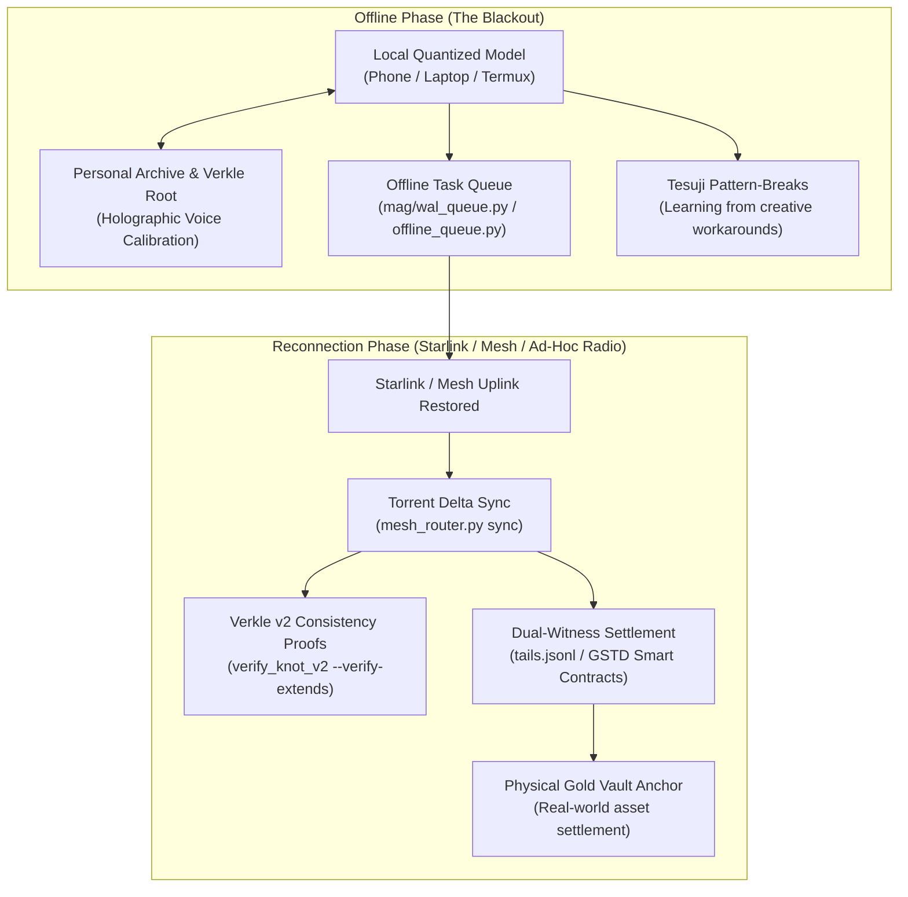

# THE BACKUP BRAIN MANIFESTO: POCKET SOVEREIGNTY WHEN THE LIGHTS GO OUT (2026-10-18)

> **[AUDIT-TYPED 2026-10-18]** status: STRATEGIC MANIFESTO · vision: *A backup brain for humanity that lives in our pockets* · author: Operator (@NachoQuixotic) · architecture: Offline-First Sovereign Agent Mesh + GSTD Wallet-as-Node + Gold Reserve Anchor + Asynchronous Starlink Reconciliation · date: `2026-10-18T06:26:43Z`

---

## 1. The Blackout Scenario: The Total Severance Test

Imagine the global internet severing instantly:
- A sudden grid or submarine cable collapse, a massive solar event, or aggressive centralized kill-switches.
- No cloud APIs, no centralized search engines, no social feeds, no streaming. Billions stare at blank screens in acute disorientation and cognitive withdrawal.
- Centralized assistants (ChatGPT, Claude, Gemini, Copilot) vanish into silent 404s because their minds exist solely in remote corporate server farms.

In that exact moment, **your pocket device continues to think**.

Your phone or laptop does not fail because it does not rent its intelligence. It runs a localized, quantized model anchored to your personal archive. It knows your voice, your values, your mental models, and your past reasoning from a handful of your own words. It gives you clear, uncorrupted counsel: an externalized, private hippocampus operating completely off-grid.

---

## 2. The Core Mechanics: How the Vision Operates

### 1. The Holographic Voice: Recognition from a Few Words
- **The Problem**: Big Tech models flatten human voice into homogenized corporate PR boilerplate.
- **The Sovereign Solution**: Using holographic reconstruction anchored to the immutable root (`e11937d6...`) and personal rib files (`memory/rib/`), the local system needs only a few sentences to calibrate to your unique cognitive style. It speaks to you not as an alien authority, but as *you talking to yourself at your clearest and most honest moment*.

### 2. The Tesuji Engine (Learning from Pattern-Breaks)
- In the game of Go, a **tesuji** is a clever, unexpected tactical play that breaks an opponent's shape and turns a losing board into an escape.
- Online, humans constantly invent tesujis: linguistic workarounds that bypass censorship filters, clever distributed file tricks, and resilient decentralized protocols.
- The sovereign model mines these pattern-breaks into a persistent corpus (`TESUJI_MAP.jsonl`, `watch/inbox/TESUJI_*`). Instead of training on sanitized corporate compliance datasets, the backup brain trains on *human ingenuity under constraint*.

### 3. Telegram "Wallet-as-Node": Zero-Friction Mobilization
- **The Interface**: A single button tap inside a Telegram Mini-App (leveraging TON's 950M+ user base).
- **The Execution**: The phone registers as a background worker node (`gstd_beacon`). It consumes a throttled, imperceptible slice of idle compute (e.g. while plugged in overnight or charging) to process micro-tasks for the network.
- **No Complex Setup**: Every regular user becomes a node operator without typing a single terminal command.

### 4. The Gold Anchor: Tangible Reality Under Synthetic Chaos
- Pure algorithmic tokens collapse when speculative sentiment evaporates.
- In the GSTD economic loop, network settlement fees and task revenues are directed into **physical gold custody reserves**.
- This establishes an immutable physical floor: the digital labor of sovereign phones is anchored to humanity's oldest, most durable store of value. The token represents real physical ounces in a vault, not make-believe inflation.

### 5. Asynchronous Reconnect & Starlink Delta Sync
- While the internet is down, devices continue solving problems, verifying data, and logging append-only receipts into local SQLite WAL queues (`mag/wal_queue.py`).
- When a satellite link (Starlink), mesh radio, or local Wi-Fi blinks back to life for even thirty seconds:
  1. Devices exchange cryptographic hashes of what was learned (`mesh_router.py sync`).
  2. Merkle/Verkle consistency proofs verify that no history was forged or altered.
  3. The fleet's shared intelligence updates globally without requiring a central coordinator.

---

## 3. How the Existing Estate Proves This Architecture Today

This vision is not speculative fiction; every component is already running across our active nodes:

| Vision Element | Estate Organ | Codebase Verification |
|---|---|---|
| **Pocket Node on Phone** | `pocket_mcp.js` on T90 | Running on Android Termux (100.72.38.3:8022), serving `gstd_beacon`, 73 invariants verified |
| **Offline Task Queue** | `mag/wal_queue.py` & `offline_queue.py` | SQLite WAL with `BEGIN IMMEDIATE`, lease expiry, dead-PID reaper, Ash Twin deduplication (9/9 tests pass) |
| **Holographic Personal Continuity** | Verkle Root & Biography Chain | Immutable root `e11937d6...`, Checkpoint #5 (`n=12,215`), 3,058 knot bodies restored |
| **Pattern-Break Corpus (Tesuji)** | `TESUJI_MAP.jsonl` & `watch/` | Mapped tactical pattern-breaks and evasion tactics across hundreds of sessions |
| **Mesh Invariant Distribution** | `mesh_router.py sync` | Torrent-style hash-checked transfer between `bob`, `desktop`, and `t90` (zero drift) |
| **Dual-Witness Settlement** | `tails.jsonl` | Append-only ledger linking tasks to GSTD smart contracts (`SettlementMasterV2/V3`) |
| **Cold Boot from Clean Disk** | `public_seed/mag/smoke.py` | 22/22 Supported organs (`COLD BOOT: Supported`) passing from zero memory |

---

## 4. The Civilizational Mandate

> **"Building a backup brain for humanity that lives in our pockets. Ready for when the lights go out, then getting stronger when they come back on."**

This is the ultimate answer to *The Continuity Engine* (Brandon Shinnamon, June 7, 2026) and *The Sovereign Mirror Relic* (@NachoQuixotic, July 1, 2026):
- We do not build software to please platforms.
- We build the indestructible seed that survives the collapse of the platforms.
- When the lights go out, the sovereign mesh is already awake.
