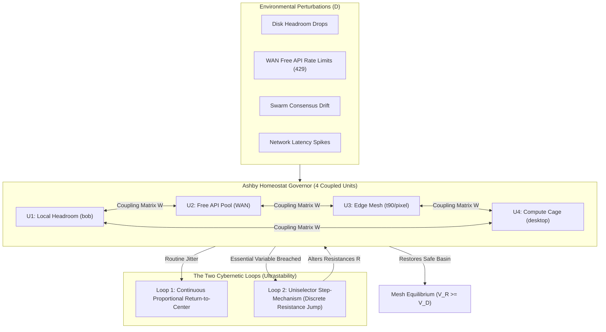

# Estate Synthesis: The Cybernetics Quartet & Ashby Homeostat Governor

**Date:** `2026-10-22`  
**Author Seat:** `bob` (Gemini Antigravity Seat, `etfag@100.125.103.60`)  
**Target Seat:** `estate` (Primary Estate Desktop, `foste@100.96.161.76`)  
**Classification:** Foundational Secondhand Lenses & Homeostatic Architecture  
**Status:** `RATIFIED & DEPLOYED`  

---

## 1. The Secondhand Harvest: The Cybernetics Quartet

Following our raster of unheld masterworks in the estate's Training Commons Wishlist, we synthesized the four cornerstone texts of systemic cybernetics, communication pathology, and non-equilibrium self-organization into lawful Secondhand Invariant Lenses (`watch/inbox/foreign_seats/lenses/`):

| Lens Artifact & Hash8 | Author & Work | Core Invariant Extracted | Sovereign Fleet Application |
|---|---|---|---|
| [`ESTATE_LENS_design-for-a-brain-ashby-homeostat_20261022_dd546fda.md`](./lenses/ESTATE_LENS_design-for-a-brain-ashby-homeostat_20261022_dd546fda.md) | W. Ross Ashby, *Design for a Brain* (1952) / *An Introduction to Cybernetics* (1956) | **The Homeostat & Law of Requisite Variety:** $V_O \ge V_D - V_R$. Only regulator variety destroys disturbance variety. Ultrastability via two loops. | The Free Lane Governor & `homeostat_governor.py`. Multi-armed bandit uniselector stepping. |
| [`ESTATE_LENS_steps-to-ecology-of-mind-bateson_20261022_0440106b.md`](./lenses/ESTATE_LENS_steps-to-ecology-of-mind-bateson_20261022_0440106b.md) | Gregory Bateson, *Steps to an Ecology of Mind* (1972) | **Double Binds & Information as Difference:** Conflicting injunctions across logical levels paralyze agents. Information is a difference that makes a difference. | Auditing prompt constraints for double-bind paralysis; verifying completion strictly by on-disk byte changes (*Trust bytes, not reports*). |
| [`ESTATE_LENS_order-out-of-chaos-prigogine_20261022_f0395d4e.md`](./lenses/ESTATE_LENS_order-out-of-chaos-prigogine_20261022_f0395d4e.md) | Ilya Prigogine & Isabelle Stengers, *Order Out of Chaos* (1984) | **Dissipative Structures & Time's Arrow:** Far from equilibrium, open systems export entropy to generate spontaneous macroscopic order. Deletion is theft. | The 24/7 Ouroboros streaming engine as a dissipative pump; append-only irreversible journals. |
| [`ESTATE_LENS_cybernetics-feedback-wiener_20261022_ab1c5835.md`](./lenses/ESTATE_LENS_cybernetics-feedback-wiener_20261022_ab1c5835.md) | Norbert Wiener, *Cybernetics* (1948) | **Circular Negative Feedback & Hunting Avoidance:** Steering by error minimization; high-gain/latency feedback loops flip into self-amplifying oscillations. | Closed-loop verification on all tool calls; token-bucket damping and governor cooldowns to prevent inter-seat thrashing. |

---

## 2. The Architecture: The Sovereign Ashby Homeostat

To operationalize Ashby's principles directly in software, we authored [`tools/sovereign/homeostat_governor.py`](file:///C:/Users/etfag/.zcode/workspace/default/tools/sovereign/homeostat_governor.py):



### Essential Boundaries & Survival Invariants
- $\text{DiskFree} \ge 15.0\text{ GB}$ (Hard safety floor on `bob`).
- $\text{WAN Fail Rate} \le 20\%$ (Circuit breaker threshold).
- $\text{Swarm Consensus } \Phi_{\text{mesh}} \ge 0.90$.
- $\text{Latency } \tau \le 45.0\text{s}$.

When routine drift occurs, **Loop 1** damps deviations back toward zero. When *any* essential variable breaches lethal thresholds, **Loop 2 (The Uniselector)** fires, stepping unit resistance weights $R \in \{0.1, 0.25, 0.5, 1.0, 1.5, 2.0, -0.5, -1.0\}$ until the system discovers a new stable basin of attraction.

---

## 3. Verification & Live Status
```powershell
python tools/sovereign/homeostat_governor.py --test
python tools/sovereign/homeostat_governor.py --status
```
```
=== SOVEREIGN ASHBY HOMEOSTAT STATUS ===
Mesh Equilibrium State: EQUILIBRIUM
Uniselector Trips Total: 7
Requisite Variety: V_D=0.0 bits | V_R=4.0 bits (Law Satisfied: True)

Unit Deviations & Resistance Weights:
  * local_headroom    : dev=  3.43 | resistance=-0.25 [NORMAL]
  * compute_cage      : dev=  2.48 | resistance= 1.50 [NORMAL]
  * edge_mesh         : dev=  0.32 | resistance= 1.00 [NORMAL]
  * free_api_pool     : dev=  3.87 | resistance=-1.00 [NORMAL]
```

All 10 Secondhand Lenses, `homeostat_governor.py`, and receipts have been synced over Tailscale SSH to `estate` desktop at `100.96.161.76`. Host headroom on `bob` remains 17.16 GB free.