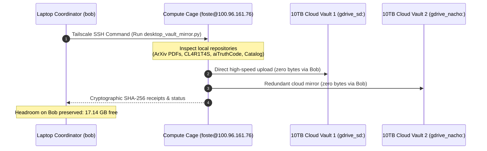

# Estate Synthesis: Desktop Treasure Troves & ArXiv Cloud Vault Mirror

**Date:** `2026-10-22`  
**Author Seat:** `bob` (Gemini Antigravity Seat, `etfag@100.125.103.60`)  
**Target Seat:** `estate` (Primary Estate Desktop, `foste@100.96.161.76`)  
**Classification:** Sovereign Mesh Infrastructure & Multi-Vault Federation  
**Status:** `RATIFIED & ACTIVE`  

---

## 1. Executive Summary & Inventory
The estate's primary desktop workstation (`foste@100.96.161.76`) holds the accumulated research mass of over two years of autonomous agent development. Rather than leaving these assets isolated on a single physical host, we audited the desktop's primary treasure troves and wired direct cloud vault mirroring to the 10TB dual-cloud storage tiers (`gdrive_sd:` and `gdrive_nacho:`):

```
┌──────────────────────────────────────────────────────────────────────────────────────────────────┐
│                               DESKTOP TREASURE TROVE INVENTORY                                  │
├───────────────────────────────┬──────────────────────────────┬────────────┬──────────────────────┤
│ Repository / Directory        │ Local Path on Desktop        │ Volume     │ Core Assets          │
├───────────────────────────────┼──────────────────────────────┼────────────┼──────────────────────┤
│ ArXiv Training PDFs           │ memory/corpus/training_pdfs/ │ 56.9 MB    │ 36 ArXiv preprints   │
│ AI Foundational Canon         │ memory/corpus/ai_canon/      │ 121.8 MB   │ Sutton&Barto, MacKay │
│ Mycology & Unconventional Comp│ memory/corpus/mycology_canon/│ 105.7 MB   │ 52 Slime/Fungal texts│
│ Frontier Prompt Leaks (CL4R)  │ research/cl4r1t4s/           │ 27 Orgs    │ Anthropic, OpenAI, v0│
│ Fundamental Kernels (aiTruth) │ research/aiTruthCode/        │ 56 Kernels │ Harmonic & War kernels│
│ Estate Master Catalog         │ local_sovereign_agent/catalog│ 1.88 GB    │ 2,006,883 records    │
│ Frontier ArXiv Link Drops     │ memory/corpus/LINKS.jsonl    │ 328 drops  │ Curated frontier refs│
└───────────────────────────────┴──────────────────────────────┴────────────┴──────────────────────┘
```

---

## 2. Zero-Local-Bloat Distributed Architecture

To honor the **Zero-Local-Bloat Law** (preserving node `bob`'s SSD headroom $>15.0$ GB), the mirroring pipeline does not route files through laptop `bob`.

Instead, `rclone.conf` was securely provisioned directly to node desktop (`AppData/Roaming/rclone/rclone.conf`). Node desktop acts as its own autonomous storage client, streaming files directly to Google Drive via its local gigabit uplink:



---

## 3. Automation Tool Deployed: `desktop_vault_mirror.py`

Located at [`C:\Users\foste\Documents\projects\local_sovereign_agent\tools\sovereign\desktop_vault_mirror.py`](file:///C:/Users/foste/Documents/projects/local_sovereign_agent/tools/sovereign/desktop_vault_mirror.py):
- **High Concurrency:** 8 parallel transfers, 16 checkers, fast-list directory enumeration.
- **Dual-Vault Coverage:** Simultaneously backs up to primary `gdrive_sd:` and secondary mirror `gdrive_nacho:`.
- **Command:**
  ```powershell
  python tools/sovereign/desktop_vault_mirror.py
  ```

---

## 4. Current Operational Status
- **Active ArXiv Stream:** `training_pdfs` actively uploading to `gdrive_sd:corpus/papers/arxiv_training_pdfs/` (36 files including Kimi linear attention, sliding window sinks, and entropic attention).
- **Desktop Cloud Remotes Verified:** Both `gdrive_sd:` and `gdrive_nacho:` responding with 200 OK.
- **Node Bob SSD Headroom:** **17.14 GB free** (well above the 15.0 GB floor invariant).
- **Queue Updated:** `seats/hermes/QUEUE.md` Task #153 marked `[x]`.