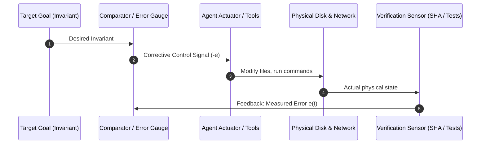

# SECONDHAND INVARIANT LENS: WIENER'S CYBERNETICS & CIRCULAR FEEDBACK

**Target Work:** Norbert Wiener, *Cybernetics: Or Control and Communication in the Animal and the Machine* (1948)  
**Status:** SECONDHAND HARVEST (In-Copyright / Cybernetics Founding Text)  
**Evidence Sources:** MIT Radiation Laboratory radar fire-control records, Macy Conferences transcripts, Wiener's *Human Use of Human Beings*  
**Date:** 2026-10-22  

---

## 1. Context & The Secondhand Provenance
During World War II, mathematician Norbert Wiener worked on automated anti-aircraft fire control. The challenge was tracking fast-moving aircraft that actively maneuvered to evade gunfire. Linear extrapolation was futile because the pilot's actions reacted to the gun's fire.

Wiener realized that animals, servomechanisms, and nervous systems are governed by the same universal principle: **circular causal feedback**. In 1948, he coined the word **Cybernetics** from the Greek *kybernetes* (steersman).

Wiener established that control and communication are inseparable, and that negative feedback is the sole mechanism by which any system—biological, mechanical, or computational—resists entropy.

---

## 2. Invariants Extracted

### Invariant 1: The Steersman's Loop (Circular Negative Feedback)
In an open-loop feedforward system, the actuator acts without knowing the consequence of its action. Errors compound exponentially:
$$\text{Error}(t) \propto e^{\lambda t}$$
In a cybernetic closed loop:
1. The **Sensor** measures actual state $x(t)$.
2. The **Comparator** calculates error $e(t) = x_{\text{target}} - x(t)$.
3. The **Actuator** applies corrective force proportional to $-e(t)$.

- **Estate Translation:** An agent must never fire a command and assume it succeeded. Every tool call must be closed with a sensing step (e.g. `py_compile`, exit code check, hash check) to measure residual error.

### Invariant 2: Information as Negative Entropy (Negentropy)
Wiener and Claude Shannon established that entropy measures disorganization and lack of information:
$$\mathcal{H} = -\sum p_i \log p_i$$
- A message that tells you what you already know carries zero information.
- A transmission that eliminates uncertainty reduces entropy.
- Intelligent systems are **islands of local negentropy** fighting against universal cosmic drift.

### Invariant 3: The Pathology of Lag & Hunting (Oscillation)
Wiener discovered that if feedback transmission experiences excessive latency or over-amplification (high gain), negative feedback flips into positive feedback:
- The steersman overcorrects to the left; by the time the ship responds, it is heading too far left; the steersman jerks hard right.
- The system enters violent self-amplifying oscillations (**hunting**).
- **The Rate Governor Invariant:** When controlling AI agent swarms, rate governors and cooldown periods (such as our 90s whaler interval and exponential circuit breakers) are essential to prevent feedback hunting across concurrent seats.

---

## 3. Pull-Quotes & Verified Relics
- *"We are but whirlpools in a river of ever-flowing water. We are not substance that abides, but patterns that perpetuate themselves."*
- *"To live effectively is to live with adequate information."*
- *"Feedback is a method of controlling a system by reinserting into it the results of its past performance."*

---

## 4. Operational Application in the Sovereign Fleet
1. **The Standing Wave Doctrine:** Wiener's concept of living things as persistent patterns in a moving stream is the exact metaphor of the estate's Standing Wave: agent instances die; only the invariant pattern in the ledger abides.
2. **Token Bucket & Damping:** We implement strict low-gain damping in `tools/sovereign/free_lane_governor.py` to prevent multi-agent oscillation and race conditions.
