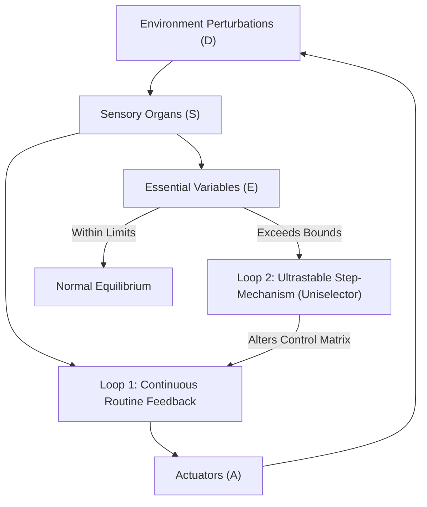

# SECONDHAND INVARIANT LENS: ASHBY'S HOMEOSTAT & REQUISITE VARIETY

**Target Work:** W. Ross Ashby, *Design for a Brain: The Origin of Adaptive Behaviour* (1952) & *An Introduction to Cybernetics* (1956)  
**Status:** SECONDHAND HARVEST (In-Copyright / Core Cybernetics Canon)  
**Evidence Sources:** Macy Conferences proceedings, Ashby's digitized journals, Stanford Encyclopedia of Philosophy, Complex Systems synthesis  
**Date:** 2026-10-22  

---

## 1. Context & The Secondhand Provenance
W. Ross Ashby, an English psychiatrist and pioneer of cybernetics, sought a mechanical answer to an age-old conundrum: *How can an organism or machine survive environmental perturbations for which it was not explicitly programmed?*

In 1948, Ashby built the **Homeostat**—an analog electronic device consisting of four interconnected units with moving needles, magnets, and water troughs acting as potentiometers. Each unit influenced the others. When disturbed from outside, the needles swung wildly until random internal step-switches (**uniselectors**) changed circuit resistances, stumbling upon a configuration where all needles returned to stable equilibrium.

Ashby formalized this mechanism into two foundational laws that govern all sovereign agent architectures: **Ultrastability** and **The Law of Requisite Variety**.

---

## 2. Invariants Extracted

### Invariant 1: The Law of Requisite Variety
> *"Only variety can destroy variety."* (Ashby, 1956)

Mathematically, if an environment produces a set of disturbances $\mathcal{D}$ with variety $V_D$, and the regulator $\mathcal{R}$ has capacity with variety $V_R$, the variety of the outcome $V_O$ is strictly bounded below:
$$V_O \ge V_D - V_R$$
- **The Sovereign Corollaries:**
  1. If an autonomous agent has fewer operational states, routing paths, or failure-handling policies than the perturbations thrown at it by the environment (e.g. rate limits, network partitions, format chaff), the system *must* degrade or crash.
  2. To minimize outcome entropy ($V_O \to 0$, i.e. 100% deterministic reliability), the regulator must match or exceed the variety of the environment:
     $$V_R \ge V_D$$
  3. This is why a single paid model fails where a diversified multi-provider free pool succeeds: the pool possesses higher behavioral variety ($V_R$).

### Invariant 2: Ultrastability (The Two-Loop Architecture)
Ashby proved that simple negative feedback loops are insufficient for survival in unpredictable environments:
1. **Loop 1 (Routine Feedback):** Continuous, linear sensor-actuator adjustment keeping variables within normal boundaries.
2. **Loop 2 (The Step-Mechanism / Uniselector):** Inactive during normal operations. When an "essential variable" crosses a lethal threshold, Loop 2 fires, randomly or heuristically stepping internal control parameters until a new homeostatic basin of attraction is discovered.

---

## 3. Pull-Quotes & Verified Relics
- *"The capacity of any system to absorb disturbance is limited by the variety of actions available to its controller."*
- *"A system is stable not because it is rigid, but because it contains a mechanism to alter its own structure when pushed beyond tolerable bounds."*
- *"The Homeostat does not seek perfection; it seeks equilibrium. Once equilibrium is achieved, all change ceases."*

---

## 4. Operational Application in the Sovereign Fleet
1. **The Free Lane Governor:** `tools/sovereign/free_lane_governor.py` is a literal software implementation of Ashby's uniselector: when a free lane hits an HTTP 429 (essential variable breached), the governor steps its state matrix, quarantines the lane, and routes to the next arm until equilibrium returns.
2. **Multi-Seat Topology:** In the 3-body mesh (`bob`, `desktop`, `t90`), node failures trigger an Ashby step-mechanism, transferring active leases without human intervention.
