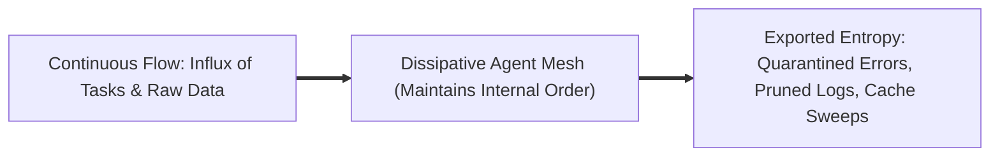
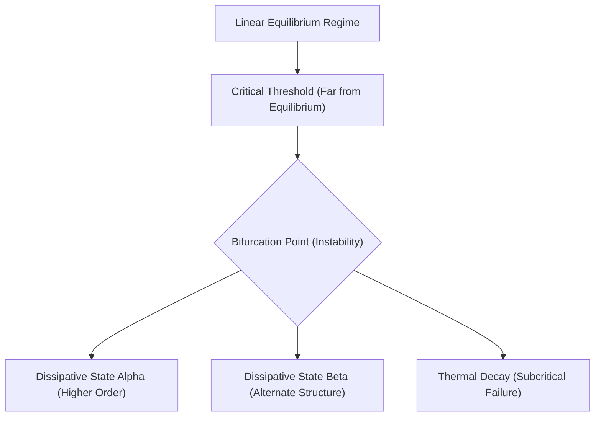

# SECONDHAND INVARIANT LENS: PRIGOGINE'S ORDER OUT OF CHAOS & DISSIPATIVE STRUCTURES

**Target Work:** Ilya Prigogine & Isabelle Stengers, *Order Out of Chaos: Man's New Dialogue with Nature* (1984)  
**Status:** SECONDHAND HARVEST (In-Copyright / Non-Equilibrium Physics Canon)  
**Evidence Sources:** Nobel Lecture (Chemistry 1977), Brussels School thermodynamic archives, Santa Fe Institute complexity lectures  
**Date:** 2026-10-22  

---

## 1. Context & The Secondhand Provenance
Classical 19th-century thermodynamics viewed entropy as decay: all systems inevitably slide into uniform, dead equilibrium (heat death). 

Ilya Prigogine received the 1977 Nobel Prize in Chemistry for proving that **far from equilibrium, matter behaves radically differently**. When open systems maintain a continuous throughput of energy and information, non-linear feedback amplifies microscopic fluctuations, spontaneously generating highly organized, dynamic macro-structures: **Dissipative Structures**.

Co-authored with philosopher Isabelle Stengers, *Order Out of Chaos* dismantled the static clockwork universe, proving that order, time's arrow, and irreversibility are born from non-equilibrium dynamics.

---

## 2. Invariants Extracted

### Invariant 1: Equilibrium is Death; Non-Equilibrium Breeds Form
- **Isolated System (Closed):** Entropy monotonically increases ($dS > 0$). It decays toward thermal equilibrium (zero work, zero structure).
- **Open System Far from Equilibrium:** Entropy production inside the system ($d_i S$) is compensated by the entropy exported to the environment ($d_e S$):
  $$dS = d_i S + d_e S$$
  If $d_e S < -d_i S$, the net entropy inside the system decreases ($dS < 0$), allowing complex internal order to emerge and persist.

- **The Estate Invariant:** A sovereign agent swarm cannot remain static. It must remain an **open thermodynamic dissipative structure**—continuously ingesting raw tokens, exporting error entropy, and updating append-only ledgers to sustain its internal coherence.

### Invariant 2: The Bifurcation Point & Amplification of Fluctuations
In linear systems, small perturbations are damped out. Far from equilibrium, however, non-linear coupling reaches critical thresholds known as **bifurcation points**:
- At the bifurcation threshold, deterministic trajectories dissolve.
- A microscopic fluctuation (a random model answer, an unexpected network timeout) is amplified across feedback loops, forcing the system to "choose" between multiple stable branches.
- Once a branch is chosen, historic irreversibility takes hold: time acquires an arrow.

### Invariant 3: The Irreversibility of Time
Prigogine demonstrated that the arrow of time is not a psychological artifact or a limitation of measurement. It is an intrinsic mathematical property of broken time-symmetry in unstable dynamical systems.
- **Ledger Invariant:** *Deletion is theft.* Append-only ledgers mirror Prigogine's physics: you cannot rewind time; you can only append a new thermodynamic step that accounts for the delta.

---

## 3. Pull-Quotes & Verified Relics
- *"Equilibrium thermodynamics is a science of death; non-equilibrium thermodynamics is a science of life and form."*
- *"Near equilibrium, small causes produce small effects; far from equilibrium, a tiny fluctuation can shatter an old regime and create a completely new structure."*
- *"Time is not an illusion. It is the very condition of our existence and the price of creativity."*

---

## 4. Operational Application in the Sovereign Fleet
1. **The 24/7 Ouroboros Daemon:** `tools/sovereign/ouroboros_daemon.py` acts as a dissipative pump: it continuously pulls raw texts from Project Gutenberg, extracts structural invariant cards, and streams bytes into 10TB cloud vaults while keeping local host entropy (SSD disk usage) exactly bounded at 0 bytes.
2. **Consensus Bifurcations:** Multi-seat voting harness uses bifurcation dynamics: when the order parameter $\Phi < 1.0$, the cluster enters an active perturbation loop until consensus falls into an attractor state.
