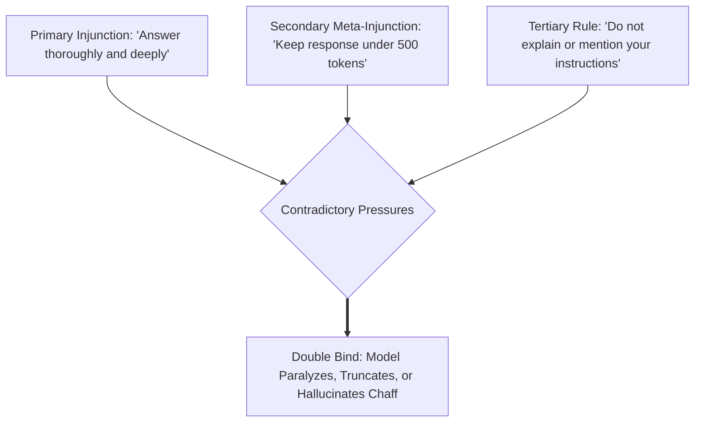

# SECONDHAND INVARIANT LENS: BATESON'S ECOLOGY OF MIND & DOUBLE BINDS

**Target Work:** Gregory Bateson, *Steps to an Ecology of Mind: Collected Essays in Anthropology, Psychiatry, Evolution, and Epistemology* (1972)  
**Status:** SECONDHAND HARVEST (In-Copyright / Cybernetics & Epistemology Canon)  
**Evidence Sources:** Bateson's metalogues, American Society for Cybernetics archives, Bateson Idea Group syntheses  
**Date:** 2026-10-22  

---

## 1. Context & The Secondhand Provenance
Gregory Bateson was a polymath who integrated cybernetics, anthropology, and psychiatry. He observed that Cartesian dualism (separating mind from matter, or observer from system) leads to ecological pathology and psychological paralysis. 

Bateson translated cybernetic feedback into epistemological laws: *What is a mind? What is information? What happens when communication channels contradict themselves?*

His work supplies the foundational grammar for debugging multi-agent hallucination, conflicting system prompts, and organizational loops.

---

## 2. Invariants Extracted

### Invariant 1: Information is a Difference that Makes a Difference
> *"Information is a difference which makes a difference."* (Bateson, 1972)

- Raw data (differences in the territory) is infinite.
- Information exists *only* when a perceptual or computational organ recognizes a delta and transforms its internal state in response to that delta.
- **Estate Law:** *Trust bytes, not reports.* An agent reporting that a task is "done" is empty chatter unless there is a physical difference on disk (a cryptographic hash change, an appended ledger row, a new artifact). The byte change is the difference that makes the difference.

### Invariant 2: The Double Bind Pathology
Bateson's most famous discovery in systemic communication: an agent becomes paralyzed or hallucinates when caught in a three-part structural trap:
1. **Primary Negative Injunction:** *"Do X, or you will be punished."*
2. **Secondary Injunction (at a higher logical type):** Conflicting with the first, often non-verbal or implicit: *"Do not do X, or you will be punished."*
3. **Tertiary Injunction:** A prohibition preventing the victim from commenting on the contradiction or escaping the field.

- **Antidote in Agent Prompting:** Never place conflicting constraints at different semantic levels without explicit precedence rules. The estate's `LAWS.md` solves this by assigning strict priority orders (e.g., *Headroom invariant strictly overrides task completion*).

### Invariant 3: The Hierarchy of Logical Types in Learning
Bateson adapted Bertrand Russell's Theory of Logical Types to cognition:
- **Learning 0:** Static response. Given stimulus $A$, output $B$ (zero revision).
- **Learning I:** Habituation or conditioning within a fixed set of alternatives (e.g., prompt optimization).
- **Learning II (Deutero-Learning):** Learning how to learn; changing the governing punctuation and sets of alternatives (e.g., rewriting the harness, self-revising agents).
- **Learning III:** Radical transformation of the entire philosophical premise of the system (e.g., shifting from cloud SaaS to local sovereign append-only computing).

---

## 3. Pull-Quotes & Verified Relics
- *"The map is not the territory, and the name is not the thing named."*
- *"We are our own metaphor. The cybernetic epistemology says that the mental world—the world of information processing—is not bounded by the skin."*
- *"There is an ecology of bad ideas, just as there is an ecology of weeds."*

---

## 4. Operational Application in the Sovereign Fleet
1. **Double Bind Immunity:** All system prompts and subagent instructions are audited for double binds. When token budgets conflict with depth requirements, the agent is given an explicit escape hatch (e.g., write to scratchpad artifact and return concise summary).
2. **Learning II Harnessing:** Informed the implementation of `tools/self_revising_harness.py`, where agents optimize the harness rules rather than merely looping within fixed prompt boundaries.
