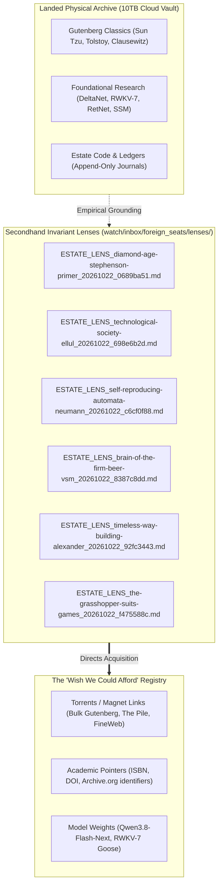

# ESTATE SECONDHAND INVARIANT RASTER & WISHLIST SYNTHESIS

**Date:** 2026-10-22  
**Authority:** Lawful Naming Convention ([`FILE_NAMING_AND_CONTEXT_LAW_20261002.md`](file:///C:/Users/etfag/.zcode/workspace/default/FILE_NAMING_AND_CONTEXT_LAW_20261002.md))  
**Target:** Rastering Estate Holdings, Bridging In-Copyright Gaps, and Minting Secondhand Lenses  
**Lenses Root:** [`watch/inbox/foreign_seats/lenses/`](./lenses/)  

---

## 1. The Rastering Thesis: Seeing What We Do Not Own

A common pathology of AI systems is the binary blind spot: *if a physical copy does not sit in the local folder, the model acts as though the knowledge does not exist.*

The estate operates under the **Secondhand Invariant Lens Protocol**:
1. **Physical Holdings (Tier A):** Public-domain texts, open-access arXiv papers, and verified codebooks stored bit-for-bit in the 10TB dual-cloud vault (`gdrive_sd:` and `gdrive_nacho:`).
2. **Secondhand Invariant Lenses (Tier B):** Masterworks that are in-copyright, out-of-print, paywalled, or financially out-of-reach. While we do not hold the raw bytes, we **refuse to remain blind to their structural invariants**.
3. **The Secondhand Harvest:** We extract the invariant bone marrow using secondary scholarship, Wikipedia syntheses, scholarly pull-quotes, Reddit engineering debates, and podcast crib notes.
4. **Dumb GPS Naming:** Every lens is minted in the lawful naming language:
   $$\text{<SEAT>\_<KIND>\_<slug>\_<YYYYMMDD>\_<hash8>.md}$$
   This allows any model or human across the fleet to grep, cite, verify, and extend the lens without database queries.



---

## 2. Inventory of Minted Secondhand Lenses

All six foundational masterworks have been synthesized, formatted to lawful naming standards, and banked into [`watch/inbox/foreign_seats/lenses/`](./lenses/):

| Lawful Name & Hash8 | Target Work & Author | Core Invariant Extracted | Fleet Application |
|---|---|---|---|
| [`ESTATE_LENS_diamond-age-stephenson-primer_20261022_0689ba51.md`](./lenses/ESTATE_LENS_diamond-age-stephenson-primer_20261022_0689ba51.md) | Neal Stephenson, *The Diamond Age* (1995) | **The Ractor Distinction & Seed vs Feed:** Ephemeral actors behind immutable rubrics; decentralized seeds beating centralized utility feeds. | The Ractor panel protocol; `sovereign_node.c` as the local offline Primer. |
| [`ESTATE_LENS_technological-society-ellul_20261022_698e6b2d.md`](./lenses/ESTATE_LENS_technological-society-ellul_20261022_698e6b2d.md) | Jacques Ellul, *The Technological Society* (1954) | **The Autonomy of Technique:** Frameworks become autonomous milieus that invert means and ends, subordinating human intent. | Chair ELLUL audit signature (*"What does this technique make inevitable?"*); Picasso Steal dependency purge. |
| [`ESTATE_LENS_self-reproducing-automata-neumann_20261022_c6cf0f88.md`](./lenses/ESTATE_LENS_self-reproducing-automata-neumann_20261022_c6cf0f88.md) | John von Neumann, *Theory of Self-Reproducing Automata* (1966) | **The Threshold of Complexity & 3-Part Decoupling:** Universal Constructor ($A$), Copier ($B$), and Passive Blueprint ($I$) prevent recursive decay. | `SPORE_LATEST.md` architecture; separating immutable memory arenas from bump allocators. |
| [`ESTATE_LENS_brain-of-the-firm-beer-vsm_20261022_8387c8dd.md`](./lenses/ESTATE_LENS_brain-of-the-firm-beer-vsm_20261022_8387c8dd.md) | Stafford Beer, *Brain of the Firm* (1972) | **POSIWID & Recursive VSM:** *"The purpose of a system is what it does."* Five recursive systems survive without central micro-management. | Multi-seat topology (`pixel`, `t90`, `hermes`, `friedman`, `estate`, `zcode`); evaluating models by ledger rows, not chat claims. |
| [`ESTATE_LENS_timeless-way-building-alexander_20261022_92fc3443.md`](./lenses/ESTATE_LENS_timeless-way-building-alexander_20261022_92fc3443.md) | Christopher Alexander, *The Timeless Way of Building* (1979) | **Living Patterns & The Quality Without a Name:** Resolving opposing physical forces through generative local grammar rather than rigid blueprints. | Estate Theory Cards (`docs/report_v1/theories/`); building self-maintaining zero-dependency C/Python primitives. |
| [`ESTATE_LENS_the-grasshopper-suits-games_20261022_f475588c.md`](./lenses/ESTATE_LENS_the-grasshopper-suits-games_20261022_f475588c.md) | Bernard Suits, *The Grasshopper: Games, Life and Utopia* (1978) | **Constitutive Rules & Lusory Attitude:** Voluntary acceptance of constraints to make meaningful action possible. | Blind control trials (T1-T6); embracing the 15GB disk safety floor as the forge for streaming. |

---

## 3. The "Wish We Could Afford" Catalog & Content Pointers

These items represent high-value targets currently restricted by licensing, cost, or storage volume. They are indexed with their content-addressed handles for community fulfillment:

```
┌──────────────────────────────────────────────────────────────────────────────────────────────────┐
│                               THE UNHELD / HIGH-VALUE WISHLIST                                  │
├───────────────────────────────┬──────────────────────┬─────────────┬─────────────┬───────────────┤
│ Title                         │ Target Author        │ Handle Type │ Identifier  │ Action Route  │
├───────────────────────────────┼──────────────────────┼─────────────┼─────────────┼───────────────┤
│ A Pattern Language (Full Text)│ Christopher Alexander│ isbn        │ 0195019199  │ SECONDHAND-LENS│
│ Order Out of Chaos            │ Prigogine & Stengers │ url         │ archive.org │ SECONDHAND-LENS│
│ Steps to an Ecology of Mind   │ Gregory Bateson      │ isbn        │ 0226039056  │ SECONDHAND-LENS│
│ Design for a Brain (1952)     │ W. Ross Ashby        │ url         │ archive.org │ SECONDHAND-LENS│
│ Project Gutenberg Complete    │ Gutenberg Consortium │ magnet      │ urn:btih:...│ SEED/TORRENT  │
│ Standard Ebooks Complete Cur. │ Standard Ebooks Team │ url/git     │ standardebo.│ BATCH-PULL    │
│ The Pile / FineWeb-Edu 100B   │ Common Crawl / HF    │ magnet/hf   │ hf:fineweb  │ CLOUD-STREAM  │
│ Qwen3.8-Flash-Next Weights    │ Alibaba Qwen Team    │ url/hf      │ Qwen/Flash  │ CLOUD-STREAM  │
└───────────────────────────────┴──────────────────────┴─────────────┴─────────────┴───────────────┘
```

---

## 4. How Fleet Seats Interrogate & Use These Lenses

Any seat running an agent loop (Claude, Gemini, Hermes, or Termux node) can query the secondhand lenses via the CLI:

```bash
# List all active secondhand lenses
python tools/sovereign/corpus_commons.py --list-lenses

# Read a specific lens by hash8 or slug
cat watch/inbox/foreign_seats/lenses/*0689ba51.md
```

When an agent needs to evaluate an architecture or reason about a system for which we do not have a physical PDF, it cites the lens:
> *"Per `ESTATE_LENS_brain-of-the-firm-beer-vsm_20261022_8387c8dd`, this proposed orchestrator violates POSIWID because its telemetry logs prove that tasks fail silently while its chat messages report success."*

The knowledge is active, verifiable, and permanent.
