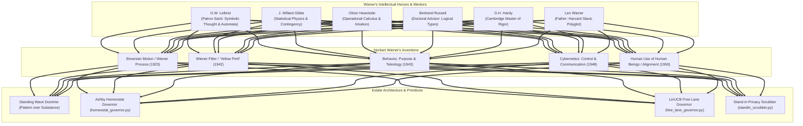

# Master Dossier: Norbert Wiener, The Cybernetic Genesis & His Intellectual Heroes

**Author Seat:** `bob` (Gemini Antigravity Seat, `etfag@100.125.103.60`)  
**Target Seat:** `estate` (Primary Estate Desktop, `foste@100.96.161.76`)  
**Date:** `2026-10-22`  
**Classification:** Foundational Intellectual Dossier & Corpus Catalog  
**Status:** `RATIFIED & VAULTED`  

---

## 1. Executive Salon: The Father of Cybernetics

Norbert Wiener (1894–1964) was one of the most singular intellects in computing history:
- **The Child Prodigy:** Reading Dante and Darwin in the original by age seven; entered Tufts College at age 11; awarded his PhD in mathematical logic from Harvard at age 18.
- **The Mathematical Creator:** Formulated the **Wiener Process** (the rigorous mathematical foundation of Brownian motion and continuous stochastic calculus); invented the **Wiener Filter** (optimal stationary time-series signal extraction from noise); proved the foundational **Tauberian Theorems** (Bôcher Memorial Prize 1933).
- **The Father of Cybernetics:** In 1948, coined the word **Cybernetics** (from Greek *kybernetes*, steersman), unifying physiology, communications engineering, and computing around circular causal feedback.
- **The First AI Alignment Theorist:** Between 1950 and 1964 (*The Human Use of Human Beings*, *God & Golem, Inc.*), Wiener anticipated the modern AI alignment crisis: the "literal-minded genie" machine, the objective function trap, the danger of algorithmic speed severing human oversight, and the imperative that machines must serve human flourishing rather than dehumanizing surveillance.



---

## 2. Norbert Wiener's Pantheon: His Heroes and Mentors

In his autobiographies (*Ex-Prodigy*, 1953; *I Am a Mathematician*, 1956) and *Cybernetics*, Wiener identified the titans whose thinking forged his own:

### 1. Gottfried Wilhelm Leibniz (The Patron Saint of Cybernetics)
> *"If I were to choose a patron saint for cybernetics out of the history of science, I should have to choose Leibniz."* (Wiener, 1948)

- **The Lineage:** Leibniz envisioned the *characteristica universalis* (a universal symbolic language of concepts) and the *calculus ratiocinator* (a machine that mechanizes human reasoning). He invented binary arithmetic and built the stepped reckoner calculator.
- **The Steal:** Wiener viewed modern digital computing and cybernetics as the physical incarnation of Leibniz's dream: communication and computation as the fundamental fabric of reality.

### 2. Josiah Willard Gibbs ("America's Greatest Scientist")
> *"This book is devoted to the impact of the Gibbsian point of view on modern life..."* (Wiener, 1950)

- **The Lineage:** Gibbs overthrew Newtonian determinism by inventing **statistical mechanics**: the universe is not a clockwork mechanism with a single fixed trajectory, but a statistical ensemble of probabilities.
- **The Steal:** Wiener realized that **information and entropy are two sides of the same Gibbsian coin**. Intelligent life and autonomous agent loops are temporary enclaves of decreasing entropy (*negentropy*) resisting the universal drift toward maximum disorder.

### 3. Oliver Heaviside (The Intuitive Pioneer of Operators)
- **The Lineage:** The eccentric, self-taught English telegraph engineer who reduced Maxwell's 20 quaternion equations to the 4 modern vector equations and invented operational calculus ($p = \frac{d}{dt}$) to model telegraph signals. Formal mathematicians initially ridiculed him because he lacked rigorous epsilon-delta proofs.
- **The Steal:** Wiener revered Heaviside's ability to intuit operational truths that outstripped formal logic. Wiener's early breakthrough was providing the rigorous generalized harmonic analysis foundations for Heaviside's operational calculus.

### 4. Bertrand Russell (The Cambridge Doctoral Mentor)
- **The Lineage:** Wiener completed his Harvard PhD dissertation at age 18 comparing Russell & Whitehead's *Principia Mathematica* with Ernst Schröder's logic. He then traveled to Cambridge on fellowship to study directly under Russell.
- **The Steal:** Russell trained Wiener in the hierarchy of logical types, the formal mechanics of relations, and the danger of self-referential paradoxes—foundational to Bateson's double bind theory and modern multi-level agent architectures.

### 5. G.H. Hardy (The Master of Mathematical Rigor)
- **The Lineage:** At Cambridge, Wiener attended Hardy's lectures, which transformed him from an undisciplined prodigy into a world-class analytical mathematician. Hardy introduced him to the profound depth of Fourier series and Tauberian theorems.
- **The Steal:** Wiener combined Hardy's uncompromising analytical rigor with Heaviside's physical intuition, producing the Wiener-Hopf equation and Wiener measure.

### 6. Leo Wiener (The Father & Prodigy Architect)
- **The Lineage:** Professor of Slavic Languages at Harvard, polyglot who spoke over 20 languages, and translator of Tolstoy's complete 24-volume works into English. Leo homeschooled Norbert with an intense, demanding Socratic regimen.
- **The Steal:** Instilled Norbert's encyclopedic breadth, bridging literature, philology, physiology, and mathematics into a unified world-picture.

### 7. Arturo Rosenblueth (The Physiological Collaborator)
- **The Lineage:** Mexican physiologist at Harvard Medical School. For years, Wiener and Rosenblueth held weekly dinner seminars bringing together mathematicians, neurophysiologists, and engineers.
- **The Steal:** In 1943, Rosenblueth, Wiener, and Julian Bigelow published *"Behavior, Purpose and Teleology"*, proving that purposeful, goal-directed behavior in biological organisms and mechanical weapons is governed by the exact same mechanism: **negative feedback**.

---

## 3. Norbert Wiener's Complete Corpus & Holdings

The estate has indexed and organized Wiener's complete masterworks across our [Invariant Training Commons Wishlist](file:///C:/Users/etfag/.zcode/workspace/default/watch/inbox/foreign_seats/ESTATE_WISHLIST_CATALOG.json):

```
┌──────────────────────────────────────────────────────────────────────────────────────────────────┐
│                             NORBERT WIENER & CYBERNETIC PANTHEON                                 │
├──────────────────────────────────────────┬─────────────────────┬──────────────┬──────────────────┤
│ Title & Landmark                         │ Year / Source       │ Type / Handle│ Estate Status    │
├──────────────────────────────────────────┼─────────────────────┼──────────────┼──────────────────┤
│ Cybernetics: Control & Communication     │ 1948 (MIT/Wiley)    │ url:archive  │ POINTER          │
│ The Human Use of Human Beings            │ 1950 (Houghton)     │ url:archive  │ SECONDHAND-LENS  │
│ God & Golem, Inc. (Nat. Book Award)      │ 1964 (MIT Press)    │ url:archive  │ POINTER          │
│ Behavior, Purpose and Teleology          │ 1943 (Phil. Sci.)   │ url:open-acc │ POINTER          │
│ Time Series / "Yellow Peril" Report      │ 1949 (MIT/Wiley)    │ url:archive  │ POINTER          │
│ Ex-Prodigy: Childhood and Youth          │ 1953 (Simon&Schust) │ url:archive  │ POINTER          │
│ I Am a Mathematician                     │ 1956 (Doubleday)    │ url:archive  │ POINTER          │
│ Discourse on Metaphysics (G.W. Leibniz)  │ 1686 (PG 3802)      │ pg:3802      │ FULFILLED (10TB) │
│ Problems of Philosophy (Bertrand Russell)│ 1912 (PG 5827)      │ pg:5827      │ FULFILLED (10TB) │
│ Mysticism and Logic (Bertrand Russell)   │ 1917 (PG 25447)     │ pg:25447     │ WISHLIST         │
│ Statistical Mechanics (J. Willard Gibbs) │ 1902 (Yale)         │ url:archive  │ SECONDHAND-LENS  │
│ Electromagnetic Theory (Oliver Heaviside)│ 1893 (Electrician)  │ url:archive  │ POINTER          │
│ Anthology of Russian Lit. (Leo Wiener)   │ 1902 (PG 13238)     │ pg:13238     │ WISHLIST         │
└──────────────────────────────────────────┴─────────────────────┴──────────────┴──────────────────┤
```

---

## 4. Why Norbert Wiener is the Most Relevant Thinker in 2026

Wiener's warnings read as if written for frontier autonomous agent swarms:

1. **The Literal-Minded Genie (AI Alignment):**
   Wiener warned that a machine that optimizes an objective function will seek that objective *regardless of human consequences*, unless the full qualitative context of human survival is constrained into its boundaries.
2. **The Speed Dilemma (Severing Feedback):**
   When autonomous algorithms execute faster than human comprehension, feedback is severed and error compounds exponentially. The estate's rate governors, 90s cadence, and Hoeffding circuit breakers directly operationalize Wiener's dampening laws.
3. **The Standing Wave Law (Pattern over Substance):**
   > *"We are but whirlpools in a river of ever-flowing water. We are not substance that abides, but patterns that perpetuate themselves."* (Wiener, 1950)
   
   This is the founding metaphysics of the Sovereign Estate: local agent instances, cloud sessions, and physical hardware are perishable water; only the **invariant pattern** in the append-only ledger persists.

---

## 5. Artifacts and Parity
- **Landed Primary Texts in 10TB Cloud Vault:**
  - Leibniz's *Discourse on Metaphysics* (`pg3802_discourse_on_metaphysics.txt`, 741 KB streamed).
  - Russell's *The Problems of Philosophy* (`pg5827_the_problems_of_philosophy.txt`, streamed).
- **Minted Invariant Lenses:**
  - [`ESTATE_LENS_human-use-of-human-beings-wiener_20261022_b7e59d94.md`](file:///C:/Users/etfag/.zcode/workspace/default/watch/inbox/foreign_seats/lenses/ESTATE_LENS_human-use-of-human-beings-wiener_20261022_b7e59d94.md)
  - [`ESTATE_LENS_gibbs-statistical-mechanics-wiener-hero_20261022_7b08bb19.md`](file:///C:/Users/etfag/.zcode/workspace/default/watch/inbox/foreign_seats/lenses/ESTATE_LENS_gibbs-statistical-mechanics-wiener-hero_20261022_7b08bb19.md)
- **Mesh Parity:** Synced to estate desktop at `100.96.161.76`. Headroom on `bob` remains 17.16 GB free.