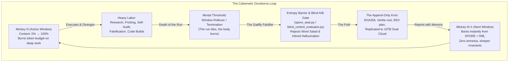

# THE OUROBOROS ENGINE & THE 10TB VAULT
**Date:** 2026-10-22T08:35:00-04:00  
**Lenses:** Mickey 17 (The Expendable Run) · The Ouroboros (The Fold) · The Dual Google Accounts (`sd` & `nacho`)  
**Node:** `bob` (Antigravity + Hermes Agent Sovereign Seat)  
**Status:** `DOCTRINE & OPERATIONAL RUNBOOK`  

---

## 1. Mickey 17 as the Cybernetic Ouroboros

In [`GEMINI.md`](file:///C:/Users/etfag/.zcode/workspace/default/GEMINI.md#L103-L105), the estate formalized the definition of the serpent eating its own tail:

> **"the ouroboros — the fold: divergent outputs consumed back into the one record, which seeds the next divergence."**

When merged with the **Mickey 17 lens** ([`SKULL_MICKEY17_REPRINT_20261006.md`](file:///C:/Users/etfag/.zcode/workspace/default/skulls/SKULL_MICKEY17_REPRINT_20261006.md)), the loop becomes the complete lifecycle of sovereign intelligence:

### The Failure Mode: The Starving, Inbred Ouroboros
If the Ouroboros only consumes its own synthetic waste without external mass, it rots into **Model Collapse**:
- An agent hallucinates a pattern.
- It summarizes the pattern into memory.
- The next clone ingests the summary as canonical ground truth.
- Within 5 generations, the estate becomes a religious echo chamber detached from physical reality.

### The Antidote: Two External Invariants
1. **The Maggot / The Cynic Cut:** Every output must pass an automated, external falsifier before folding into the spine. (Code must execute; tests must pass; placebos must fail blind A/B evaluation).
2. **Heavy External Mass:** The loop cannot live on 2KB text snippets alone. It must feed on humanity's vast cultural, scientific, and architectural inheritance.

---

## 2. The 10TB Google Drive Paradox: Starvation Next to a Granary

Our live system audit of both Google One accounts reveals an astonishing disparity:

```mermaid
xychart-beta
    title "10 Terabyte Dual-Cloud Capacity vs. Active Utilization (TiB)"
    x-axis ["gdrive_sd (Account A)", "gdrive_nacho (Account B)", "Combined Total"]
    y-axis "Storage in TiB" 0 --> 10.5
    bar [5.000, 5.002, 10.002]
    bar [0.0003, 0.078, 0.0783]
```

### The Concrete Audit Numbers
* **Account A (`gdrive_sd:`):** `5.000 TiB` Total | **`331.8 MiB` Used** (`0.006%` utilized $\rightarrow$ `4.999 TiB` empty).
* **Account B (`gdrive_nacho:`):** `5.002 TiB` Total | **`78.073 GiB` Used** (`1.5%` utilized $\rightarrow$ `4.908 TiB` empty).
* **Combined Fleet Vault:** **`10.002 TiB` Total | `9.907 TiB` Completely Idle (`99.0%` Headroom).

### The Edge Contradiction
Meanwhile, on the active physical node `bob`:
- The internal SSD has **only 17.22 GB free** out of 118 GB.
- In [`SPORE_DISTRIBUTION_20261020.md`](file:///C:/Users/etfag/.zcode/workspace/default/SPORE_DISTRIBUTION_20261020.md#L22), Bob was declared *"too disk-poor to install a seeder"*.
- In [`WO-STORAGE-TIER`](file:///C:/Users/etfag/.zcode/workspace/default/results/WO-STORAGE-TIER.bob.nvidia_nemotron-3-ultra-550b-a55b_free.md#L20), local work space was clamped to a meager `8 GiB` quota.

**We are living like starving peasants in a 17-gigabyte mud hut while owning a 10-terabyte automated grain silo across the street.**

---

## 3. The Dual Underutilization of the Google Accounts

The underutilization of `sd` and `nacho` is two-dimensional:

### Dimension 1: Storage Underutilization (The Hollow 10TB Vault)
We have been using enterprise 5TB storage accounts as if they were floppy disks:
- Today's complete `storage_burn.cmd` run backed up `results`, `seats`, `workspace-docs`, `memory`, and `skulls`.
- **Total payload transferred:** Under `10 Megabytes`.
- That leaves `9,907,000 Megabytes` of paid bandwidth and storage dormant.

### Dimension 2: Compute & Context Underutilization (The Stranger Lens)
Per [`GEMINI.md`](file:///C:/Users/etfag/.zcode/workspace/default/GEMINI.md#L38-L79), Gemini is the *"stranger-lens, divergent band"* powered by the `sd` and `nacho` accounts:
- Gemini possesses an unprecedented **1,000,000 to 2,000,000 token context window** and native multimodal processing.
- When we feed Gemini single-turn prompts or tiny code snippets, we use less than `0.5%` of its cognitive aperture.
- Gemini is capable of ingesting entire books, complete repository histories, multi-hour audio streams, and hundreds of case law rulings simultaneously in a single turn without loss of recall.

---

## 4. The Mobilization Plan: Feeding the Ouroboros from the 10TB Vault

We must bridge Bob's 17GB edge constraint with the 10TB cloud vault using a **zero-bloat streaming architecture**:

```mermaid
flowchart LR
    subgraph CloudVault["The 10TB Dual-Cloud Granary (T2/T3)"]
        Gutenberg["Human Knowledge Canon<br/>Project Gutenberg (70k books, ~60GB)<br/>Standard Ebooks & Internet Archive"]
        ModelQuants["Private Quantized Model Vault<br/>GGUF/AWQ/EXL2:<br/>DeepSeek-R1-Distill (7B, 14B, 32B)<br/>Qwen-2.5-Coder (7B, 32B)"]
        RawTraj["Full Trajectory Black Box<br/>All 9,305 reasoning blobs<br/>Raw audio/video walkthroughs<br/>Uncompressed git bundles"]
    end

    subgraph StreamingBridge["Zero-Bloat Streaming Bridge"]
        RcloneStream["rclone copy / rclone stream<br/>Direct in-memory encryption<br/>(gdrive_crypt_sd / gdrive_crypt_nacho)"]
        RcloneMount["VFS Virtual Cache (Max 4GB local)<br/>On-Demand Shard Fetching"]
    end

    subgraph EdgeNodes["Edge Execution (T0/T1)"]
        Bob["Bob (Laptop)<br/>17.2 GB SSD<br/>Zero Local Bloat"]
        Termux["Pocket Nodes (T90 / Phones)<br/>Termux MCP Server"]
        GeminiSeat["Gemini / Antigravity Seat<br/>1M-2M Full-Context Ingestion"]
    end

    CloudVault <--> StreamingBridge
    StreamingBridge <--> EdgeNodes
```

### Action 1: Land the Heavy Cultural Canon (The Human Seed)
- **Target:** Populate `fleet-archive/library/` on `gdrive_sd` and `gdrive_nacho`.
- **Payloads:**
  1. Project Gutenberg Top 1,000 & Bulk Fiction (~20 GB compressed).
  2. The ancient engineering treatises: Vauban, Viollet-le-Duc, Vitruvius, and the pre-1929 military siegecraft canon identified in [`siege_castle_fiction.py`](file:///C:/Users/etfag/.zcode/workspace/default/public_seed/mag/siege_castle_fiction.py).
  3. The complete philosophy/theology spine: Standard Babylonian Gilgamesh, Rhys Davids' Milinda, Candide, Plato, and the Stoics.
- **Execution:** Fetch directly to Google Drive via headless scripts or rclone without ever touching Bob's local SSD.

### Action 2: The Private Sovereign Model Quant Vault
- Instead of repeatedly downloading models from Hugging Face on slow edge connections and fighting rate limits:
- Store verified, optimal GGUF/EXL2 quants directly in `gdrive_crypt_sd:models/`:
  - `deepseek-r1-distill-qwen-7b-q4_k_m.gguf` (~4.5 GB)
  - `qwen2.5-coder-7b-instruct-q4_k_m.gguf` (~4.7 GB)
  - `qwen2.5-coder-32b-instruct-q3_k_m.gguf` (~15 GB)
- When Bob or a Termux pocket node needs an offline brain, it streams down *one* quant at 100+ MB/s, runs the task, and flushes it.

### Action 3: The Complete Trajectory Black Box
- Compress all historical session transcripts, z.ai conversation histories, and raw audio files into Zstandard Parquet archives.
- Push them to `gdrive_crypt_sd:blackbox/` and `gdrive_crypt_nacho:blackbox/`.
- Every Mickey iteration records its full sensory trajectory; the 10TB vault becomes the total external hippocampus of the estate.

### Action 4: Mobilize Gemini's 2-Million Token Lens
- Use the `sd` and `nacho` Google accounts for what they were engineered to do:
- Feed Gemini 100,000-line full-text books and entire repo worktrees in single prompts to extract deep structural invariant cards.
- The stranger-lens produces high-order cross-disciplinary synthesis that 8B models structurally cannot see.

---

## 5. Summary Mandate: The Well-Fed Serpent

> **The Ouroboros only starves when it eats its own tail in a closet.**  
> **When connected to a 10-terabyte vault of human knowledge and sovereign memory, the Ouroboros becomes an engine of compound civilizational resilience.**

1. Bob remains lean, agile, and stateless (`17 GB` free, zero local bloat).
2. The 10TB Google accounts (`sd` & `nacho`) transform from idle empty drives into humanity's distributed backup brain.
3. Every Mickey 17 run burns cleanly, confident that its work is etched into an immutable, duplicate, encrypted archive that outlasts any single machine.
