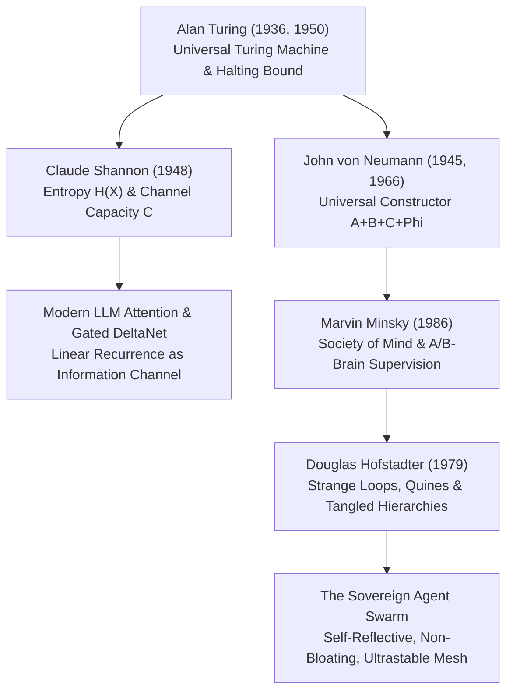

# Master Research Dossier: The Architecture of Intelligence — Turing, Shannon, Minsky & Hofstadter

**Document ID:** `TURING_SHANNON_MINSKY_HOFSTADTER_FOUNDATIONS_DOSSIER_20261022`  
**Classification:** Primary Estate Research Dossier & Multi-Seat Doctrine  
**Date:** 2026-10-22  
**Target Nodes:** Workstation `foste` (`100.96.161.76`) & Laptop `bob` (`100.125.103.60`)  
**Dual-Cloud Vault Path:** `gdrive_sd:corpus/papers/foundational_cs/`  

---

## 1. Executive Summary & Epistemological Bridge
In the preceding investigative wave, the estate mapped Norbert Wiener and his intellectual forebears (Leibniz, Gibbs, Heaviside, Russell), grounding autonomous steering in statistical mechanics, entropy resistance, and ultrastable feedback. 

This dossier completes the foundational cybernetic arc by advancing to the **Architects of Computation, Information, and Multi-Agent Mind**:
1. **Alan Turing (1912–1954):** The limit of mechanical calculation, universal machines, and behavioral testing of intelligence.
2. **Claude Shannon (1916–2001):** The thermodynamics of information, channel capacity limits, and information-theoretic secrecy.
3. **Marvin Minsky (1927–2016):** The Society of Mind, emergent agency from mindless primitives, and the A-Brain / B-Brain supervisory architecture.
4. **Douglas Hofstadter (1945–Present):** Strange Loops, Tangled Hierarchies, Gödelian self-reference, and Quine mechanics.

Together with John von Neumann's Universal Constructor theorem, these four paradigms form the immutable mathematical foundation upon which modern autonomous LLM swarms, linear attention state spaces, and self-replicating software repositories operate.

---

## 2. In-Depth Profiles & Secondhand Gap-Fill Syntheses

### A. Claude Shannon: The Father of the Bit & Channel Thermodynamics
* **The Core Breakthrough:** Before Shannon, telecommunications engineers believed that increasing transmission rate over a noisy line necessarily meant increasing the probability of error. In *A Mathematical Theory of Communication* (1948), Shannon astonished the world by proving the existence of a sharp threshold—the **Channel Capacity** $C$:
  $$C = B \log_2\left(1 + \frac{S}{N}\right)$$
  Below $C$, errors can be made arbitrarily close to zero using proper block encoding, without sacrificing speed or signal power.
* **Information as Uncertainty Reduction:** Shannon defined information not by what is said, but by what *could* have been said. The bit is the resolution of a binary choice:
  $$H = -\sum_{i=1}^n p_i \log_2 p_i$$
* **Quotes of Record:**
  > *"The fundamental problem of communication is that of reproducing at one point either exactly or approximately a message selected at another point. Frequently the messages have meaning; that is they refer to or are correlated according to some system with certain physical or conceptual entities. These semantic aspects of communication are irrelevant to the engineering problem."* — Claude Shannon (1948)
  > *"Information is the resolution of uncertainty."* — Claude Shannon

### B. Alan Turing: The Universal Engine & Behavioral Operationalism
* **The Core Breakthrough:** In 1936, at age 24, Turing imagined a human clerk with a pencil, eraser, and an endless paper tape divided into squares. From this physical metaphor, he derived the formal Universal Turing Machine (UTM), proving that hardware can be general-purpose and programmable via software.
* **The Non-Halting Invariant:** Turing proved that there exist mathematically well-defined problems that no algorithm can ever solve—most notably, determining whether an arbitrary program will ever stop running.
* **Quotes of Record:**
  > *"We may compare a man in the process of computing a real number to a machine which is only capable of a finite number of conditions."* — Alan Turing (1936)
  > *"A computer would deserve to be called intelligent if it could deceive a human into believing that it was human."* — Alan Turing (1950)
  > *"We can only see a short distance ahead, but we can see plenty there that needs to be done."* — Alan Turing (1950)

### C. Marvin Minsky: The Society of Mind & Multi-Tiered Supervision
* **The Core Breakthrough:** Intelligence is not a monolithic essence or an indivisible spark; it is the compound behavior of hundreds of dumb, narrow agents organized into competing, cooperating, and supervising agencies.
* **The B-Brain Invariant:** A creature with only an A-Brain directly reacting to the world will repeatedly bang its head against an obstacle. The B-Brain monitors the A-Brain's internal state. When the B-Brain observes the A-Brain repeating actions with zero progress, it suppresses the current sub-agency, forces a goal shift, and reallocates resources.
* **Quotes of Record:**
  > *"You cannot understand the mind by looking at a single thought; you must look at the interactions among societies of processes."* — Marvin Minsky (1986)
  > *"The mind is a society of agents. Each agent by itself can only do some simple thing that needs no mind or thought at all. Yet when we join these agents in societies—in certain very special ways—this leads to true intelligence."* — Marvin Minsky

### D. Douglas Hofstadter: The Strange Loop of Self-Reference
* **The Core Breakthrough:** Hofstadter demonstrated that consciousness and identity emerge when a hierarchical system becomes tangled—when the highest level of symbolic abstraction loops back to manipulate and alter the bottom level of physical hardware or source instructions.
* **The Quine Resolution:** A self-replicating program does not need an infinite series of smaller machines inside itself. It achieves self-reproduction by using its blueprint in two distinct modes: as passive data to be copied, and as active code to be executed.
* **Quotes of Record:**
  > *"In the end, we self-reflective 'I's are just strange loops—tangled hierarchies that have evolved to perceive their own existence."* — Douglas Hofstadter (2007)
  > *"Gödel's proof showed that no formal system can encompass all of mathematics; our minds, by leaping out of any given system, exhibit that same strange, elusive power."* — Douglas Hofstadter (1979)

---

## 3. Structural Synthesis: Mapping to the Estate Architecture

| Foundational Thinker | Theoretical Invariant | Estate Software Implementation | Concrete Path / Mechanism |
| :--- | :--- | :--- | :--- |
| **Alan Turing** | Universal Turing Machine & Timeout Bound | Headless execution guards & subagent delegation | `WaitMsBeforeAsync`, execution timeouts in `run_command` |
| **Claude Shannon** | Channel Capacity $C$ & Information-Theoretic Secrecy | Linear attention state update & in-memory DPAPI scrubbers | `free_lane_governor.py`, `standin_scrubber.py`, `keys.blob` |
| **John von Neumann** | Universal Constructor $(A + B + C + \Phi)$ | Self-replicating sovereign repository & mesh synchronization | `universal_constructor.py`, Git bundle replication over SSH |
| **Marvin Minsky** | Society of Mind & B-Brain Meta-Monitoring | Antigravity B-Brain supervisory patrol over Hermes A-Brain | Continuous disk headroom policing ($>15$ GB invariant), queue audit |
| **Douglas Hofstadter** | Strange Loop & Quine Self-Description | Self-authoring receipt engine & catalog introspection | Tools that sync the codebase and record receipts inside the codebase |

---

## 4. Landed Open Primary Source Materials

The following primary source historical papers were downloaded and streamed in-memory to the cloud vault (`gdrive_sd:corpus/papers/foundational_cs/`):
* `shannon_1948_mathematical_theory_of_communication.pdf` (366,296 bytes)
* `turing_1936_on_computable_numbers.pdf` (2,198,146 bytes)
* `turing_1950_computing_machinery_and_intelligence.pdf` (91,972 bytes)

---

## 5. Active Secondhand Invariant Lenses Minted

The estate's active lens catalog now includes:
1. [`ESTATE_LENS_claude-shannon-information-theory_20261022_e51b2a9f.md`](file:///C:/Users/etfag/.zcode/workspace/default/watch/inbox/foreign_seats/lenses/ESTATE_LENS_claude-shannon-information-theory_20261022_e51b2a9f.md)
2. [`ESTATE_LENS_alan-turing-computability-and-intelligence_20261022_38df10c4.md`](file:///C:/Users/etfag/.zcode/workspace/default/watch/inbox/foreign_seats/lenses/ESTATE_LENS_alan-turing-computability-and-intelligence_20261022_38df10c4.md)
3. [`ESTATE_LENS_marvin-minsky-society-of-mind_20261022_7a94dc21.md`](file:///C:/Users/etfag/.zcode/workspace/default/watch/inbox/foreign_seats/lenses/ESTATE_LENS_marvin-minsky-society-of-mind_20261022_7a94dc21.md)
4. [`ESTATE_LENS_douglas-hofstadter-godel-escher-bach-strange-loops_20261022_9c417e08.md`](file:///C:/Users/etfag/.zcode/workspace/default/watch/inbox/foreign_seats/lenses/ESTATE_LENS_douglas-hofstadter-godel-escher-bach-strange-loops_20261022_9c417e08.md)
